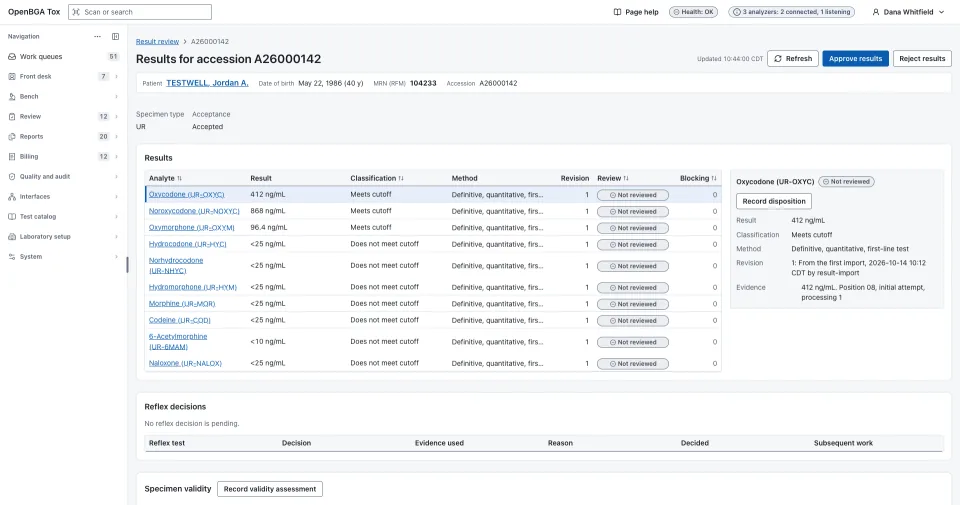

# Steady State LIMS: a free, open-source LIS for toxicology labs

[Presentation website](https://openbga.github.io/steady-state-lims/) ·
[Download](https://github.com/openbga/steady-state-lims/releases/latest) ·
[Documentation](docs/README.md) ·
[Contributing](CONTRIBUTING.md) ·
[Security](SECURITY.md)

Steady State LIMS is a free, open-source laboratory information system (LIS/LIMS)
for small **US clinical toxicology** laboratories, such as physician-office labs and
small independent tox labs. It runs as a desktop application on one laboratory
computer, which holds the laboratory's records, with no server, subscription or
internet connection required. It is built with a Rust engine, Tauri 2 and a
TypeScript/React interface for Windows, macOS and Linux.

[](https://openbga.github.io/steady-state-lims/)

It covers a test from order to delivered report:

- **Orders and accessioning:** orders recorded as the clinic supplied them, specimen receipt and barcode labels.
- **Bench:** worklists and runs, ASTM and Olympus AU400/AU640 analyzer interfaces, LC-MS/MS result files and quality control.
- **Review and release:** technical review, QC and identity holds, and versioned PDF reports.
- **Delivery and billing:** delivery logged with its evidence and a clinical billing handoff based on performed work.
- **Audit and data ownership:** personal accounts with two-factor sign-in, a tamper-evident audit trail, encrypted backup, restore and complete data export.
- **A head start:** a standard catalog for urine and oral fluid drug testing, loaded as drafts for the lab to approve, and a demo laboratory.

See [the product at a glance](docs/overview.md) and the [project scope](docs/project-scope.md)
for what it covers and excludes.

**Status: development on synthetic data.** There is no supported installer release
or clinically validated application. The [implementation status](docs/planning/implementation-plan.md#status)
records current capability; [quality guidance and limitations](docs/quality/README.md)
record what remains before laboratory use.

## Vibe coded, with sustained human effort

Steady State LIMS is built with substantial AI assistance. The vibe is part of how the
project moves: exploring ideas, generating code, and iterating quickly. Sustained
human work gives that process direction through research, requirements analysis,
architecture review, code review, test design, hands-on testing and revision.
People decide what the system should do, challenge the proposed design, examine
failures and decide what needs more work.

That work is open to inspection in the [requirements](docs/requirements/functional-requirements.md),
[architecture decisions](docs/architecture/decisions/README.md),
[engineering and review standards](docs/governance/engineering-standards.md#human-direction-and-review)
and [quality guidance](docs/quality/README.md). AI assistance and human effort both
matter; neither establishes clinical readiness. Review requirements, completed
checks and unresolved gaps are recorded separately so readers can assess the work
on its evidence.

## Download or run from source

Unsigned development installers for Windows, macOS and Linux are on the
[releases page](https://github.com/openbga/steady-state-lims/releases): a `nightly` prerelease
of `develop` and versioned releases from `main`
([branches and releases](docs/development/releases.md)). To run from source, install Rust through
[rustup](https://rustup.rs/) (the repository pins its toolchain), Node.js 24 with npm,
and the [Tauri 2 prerequisites](https://v2.tauri.app/start/prerequisites/) for your
operating system. Then, from a clone of the repository:

```bash
npm ci
npm run tauri dev
```

The [developer guide](docs/development/README.md) covers platform-specific build tools,
narrower commands and the quality gate. Use synthetic data only.

## License and development disclaimer

Copyright 2026 Steady State LIMS contributors. Respective rights holders retain
ownership; this attribution does not assign rights to a separate organization.
The project's own code, documentation, synthetic fixtures, website and original
presentation assets are licensed under the [GNU General Public License, version 3
only (GPL-3.0-only)](LICENSE), unless otherwise identified. Third-party material
retains its own terms. Use, modification and redistribution, including commercial
sale, are permitted. Distributors must preserve the GPL rights and provide the
corresponding source as the license requires. Private internal modifications do
not require public release; GPLv3 adds no AGPL-style network-source requirement.
The [license decision](docs/architecture/decisions/0017-gplv3-license.md)
defines the project license and distribution responsibilities.

AI-assisted development and human review and testing do not guarantee correctness,
security, regulatory compliance or fitness for clinical use. The work is provided
**as is**, with the warranty disclaimers and
liability limitations in GPLv3 sections 15–17, subject to applicable law and
written agreements. See the
[full development disclaimer](docs/governance/development-disclaimer.md), which does
not modify the license or add use restrictions.

## Support

Community support is through [GitHub issues](https://github.com/openbga/steady-state-lims/issues).
Are you looking for support? Contact [bgasoft.com](https://bgasoft.com).

## Start here

1. [At a glance](docs/overview.md) and [project scope](docs/project-scope.md): the product, its confirmed clinical scope and exclusions.
2. [Documentation index](docs/README.md): operation, development, architecture, requirements and supporting evidence.
3. [Architecture overview](docs/architecture/overview.md) and [decision records](docs/architecture/decisions/README.md): accepted decisions and remaining proposals.
4. [Open questions](docs/planning/open-questions.md): decisions requiring laboratory, counsel or project-owner input.
5. [AGENTS.md](AGENTS.md): instructions for any agent working here; [`.ai/`](.ai/README.md) contains reusable role definitions and skills.

For hands-on use, see the [laboratory operator guide](docs/operations/README.md) and [developer guide](docs/development/README.md).

See [contribution guidance](CONTRIBUTING.md), [security reporting status](SECURITY.md), and the [open-source strategy](docs/governance/open-source-strategy.md).
