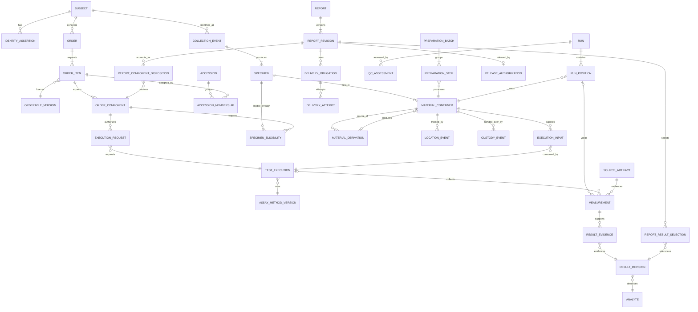

# Conceptual domain model

Status: conceptual domain model. [Current local contracts](#current-local-contracts) identifies the implemented records; optional cloud services, disclosure workflows and other proposed concepts keep their recorded decision status. The model is not an approved laboratory configuration.

Modules share one SQLite database with one serialized writer on the host computer; clinical writes, release decisions and their audit and outbox records commit in the same transaction ([transaction design](overview.md#transaction-and-failure-design)). Cloud services would hold projections and requests, never clinical state (INV-14). See [workflows and invariants](../requirements/workflows.md) for behavior and [integrations](integrations.md) for exchange boundaries.

## Modules, records and ownership

| Owning module | Principal concepts | Boundary and invariants |
| --- | --- | --- |
| Security and audit | Actor, RoleGrant, MethodAuthorization, AuditEvent | One laboratory installation; client/site/program access is scoped. Actors are per-person local accounts on the shared host computer, with offline MFA (REQ-IDN-004); clinic users are external authors, not LIS actors. Technical administration and laboratory signatory authorization are distinct. |
| Identity and organizations | LabOperator, Site, ReviewLocation, ClientOrganization, ClientArrangementReference, Practitioner, PractitionerEnrollmentCheck, Subject, SubjectIdentifier, IdentityAssertion, IdentityCorrection | External identifiers include assigning authority; identity links never grant access to every client's records. Preserve assertions before and after correction. |
| Catalog and orders | OrderableVersion, PanelComponent, Order, OrderItem, OrderComponent, OrderAuthorization, OrderChangeRequest, ClinicalContext, OrderPolicyVersion, ClientOrderProfileVersion, StandingOrderAuthorization, OrderDiagnosis, MedicalNecessityEvidence, MedicationStatement, ReportedPointOfCareResult, PortalOrderRequest, PortalOrderRequestVersion, CatalogPublication | Accepted orders freeze their component manifest and authority. Add-on/reflex, technical repeat and cancellation have different authorization and service consequences. Diagnoses and medications keep the ordering source's provenance; the lab never originates them. A portal order request is not an order until the LIS accepts it. |
| Clinical configuration | AssayMethodVersion, Analyte, AnalyteRelationshipVersion, RuleSetVersion, InterpretiveRuleSetVersion, MedicationMappingVersion, ValidityPolicyVersion, PublicHealthReportingRuleVersion, ReportingPolicyVersion (with ReportDisplayGrouping), MappingVersion | Draft → approved → retired lifecycle; immutable approved versions with effective intervals and explicit replacement. Routine supersession permits existing ordered work under its approved pin. Explicit retirement/safety suspension remains a separate blocking control; historical interpretation and artifacts retain their original references. Administrators approve and activate application versions under configurable separation of duties; the laboratory supplies clinical content and may retain formal approvals externally. Consuming modules retain exact references; configuration approval grants no order/review/release authority (ADR 0018). An Analyte keeps its identity: `manage_configuration` corrects its name, LOINC and drug class codes or retires it as a new revision with a reason, an immutable history and an audit event. Its code changes only while no record refers to it. Retirement blocks new method versions and source test-code maps and is refused while a current or draft method version includes it. Issued reports keep the text they froze; whether a correction to an analyte of an approved method needs Catalog review is open (Q-23). |
| Specimens | Accession, AccessionMembership, CollectionEvent, Specimen, SpecimenEligibility, MaterialContainer, MaterialDerivation, AcceptanceDecision, LocationEvent, CustodyEvent, StorageConditionEvent | Accession is a lab work grouping; specimen is collected biological material; container is a physical holder. Prepared aliquots derive from parent material and are not new patient collections. |
| Analytical operations | TestExecution, ExecutionRequest, ExecutionInput, PreparationBatch, PreparationStep, Run, RunPosition, Instrument, UpstreamReviewSystem, Lot, CalibrationAssessment, QCAssessment, Deviation | Preparation batch and run are separate; controls/calibrators/blanks are material roles, not fake patients. Execution authority and consumed material have explicit links. Failed evidence remains traceable. |
| Results | SourceArtifact, ImportAttempt, ProcessingRevision, UpstreamReviewAttestation, Measurement, ResultEvidence, ResultRevision, DerivedResult, ValidityAssessment, InterpretationResult, TechnicalReview, ReleaseGateDecision | A measurement is source evidence; a result revision is a candidate clinical representation selected from evidence under approved rules. Review is a separate decision bound to that revision. Retesting creates new executions. |
| Reporting | Report, ReportRevision, ReportResultSelection, ReportComponentDisposition, ReleaseAuthorization, Recipient, DeliveryObligation, DeliveryAttempt, DeliveryEvidence, RecipientAccessEvent, DestinationVerification, NotificationRecord, PublicHealthReportObligation | Released content is immutable. Completeness, amendment relationship and current availability are separate facts. Recipients and delivery evidence are revision-specific; every evidence record names channel and evidence level (INV-15). |
| Referral coordination | ReferralOrder, ReferralShipment, ExternalReportRevision | Referral results preserve the actual performing lab and source report. Local issuance and service reconciliation retain distinct authority. |
| Billing handoff | PerformedServiceEvent, ServiceDerivation, DrugClassTaxonomyVersion, AnalyteBillingClassMapping, PayerCodeSetVersion (with DateOfServiceRule), PayerPolicyReference, BillingHandoff, ChargeAdjustment | Handoff is idempotent and independent from clinical evidence; performed work and payment approval remain different facts. Billing reads clinical facts. No clinical module reads billing outcomes. |
| Disclosure and records requests | PatientAccessRequest, DocumentationRequest, EvidencePackage, DisclosureRecord | Requests are assembled from references to retained records; nothing is created or altered to answer one. Requester verification, legal basis, due date, minimum-necessary and Part 2 review, and disclosure logging are explicit. EHI exports reuse EvidencePackage. Owners: privacy officer (patient access) and billing/compliance with privacy review (payer/auditor requests). |
| Quality and operations | Nonconformance, CorrectiveActionReference, ControlledDocumentReference, CompetencyReference, RetentionPolicyVersion, LegalHold, DispositionRecord, SoftwareRelease, UpdateApproval, BackupSnapshot, RestoreVerification, AnchorRecord | Initial pilot can link to external QMS records while enforcing local release blocks and preserving audit evidence. No software version runs in production without a recorded lab approval; backups and anchors are evidence records, not just files. |
| Integration and cloud link | InboundReceipt, Device, DeviceEnrollment, DeviceRevocation, RelayMessage | The LIS receipt is the only acceptance-bearing receipt; edge and cloud receipt IDs are correlation data. Only the currently enrolled device may exchange with the cloud. |
| Clinic services | ClientLocation, ClinicUserReference, ClinicAuthorization, ServiceEnablement, FurnishedServiceRecord | Clinic users act only within the clinics and locations a lab authorizes, separately per lab. Service enablement is per lab; furnished services are recorded per clinic. |

The table is a conceptual inventory, not an implementation checklist. Current records are identified below and in the [implementation plan](../planning/implementation-plan.md#status). Cloud/portal concepts follow [ADR 0010](decisions/0010-optional-cloud-services.md); disclosure, interpretation and other decision-dependent capabilities retain their [scope status](../quality/scope-decisions.md).

## Current local contracts

[ADR 0018](decisions/0018-remediation-authority-and-method-continuity.md) governs configuration authority, accepted-work continuity and collection-based standing authority. The [implementation plan](../planning/implementation-plan.md#status) records current local scope; the [quality gates](../quality/README.md) retain outstanding acceptance work.

| Record / owner | Implemented representation and boundary |
| --- | --- |
| Receipt decisions and location events / specimens | Append-only causal links bind events to aggregate revisions; original rows/times remain unchanged. Legacy audit links are accepted only when uniquely established. Missing receipt order blocks testing/release. Manage-quality source review supplies every decision in explicit order with reason and expected revision; contradictions are refused. Ambiguous location history displays unknown until an attributable verified current move; no historical order is fabricated. |
| Method version and accepted component / catalog, orders, analytical | New current versions may activate while older accepted work remains. Run creation, preparation and repeat/re-extraction/dilution use the existing approved component pin, preserving ordered analytes. Explicit retirement/suspension and identity/QC/validity/material/release gates remain effective. Approved method notes and per-analyte reference information are separate from cutoffs and reportable-range policy. |
| Performing laboratory / analytical and reporting | New runs pin an immutable laboratory profile. Legacy unknown sites remain unknown until a quality-authorized append-only resolution identifies the historical profile, source reference and reason. Known sites cannot be replaced by this recovery action. New report preparation/release is blocked for performed results lacking site evidence. Current reporting contact is distinct from each selected measurement's historical performing profile. |
| Client, location and practitioner / identity | Corrections and active state create versioned factual history with actor/time/reason. A migrated baseline explicitly lacks an inferred actor; its origin is labelled legacy. New orders require active sources; already accepted orders retain their identities. Directory retirement neither rewrites issued reports nor silently stops already accepted clinical work. |
| Incomplete identity intake / identity | A retained deferral preserves supplied name and unknown, partial-date or supplied-age evidence as text, with source reference/reason and attribution. It is not a patient identifier and cannot authorize orders/testing. Resolution links an independently verified patient, or records a declined disposition, with new source/reason; no DOB is invented or derived from age. |
| Patient-specific standing authority / orders and specimens | Patient, practitioner, source, approved scope, inclusive validity dates and optional visit limit remain explicit. Date-only collection uses its supplied date; instant evidence uses its original offset, not current UTC intake or current laboratory timezone. Unknown timing blocks testing/release. Corrections recheck authority even after quality review; that review cannot extend authorization. Acceptance reserves a use; cancellation does not automatically recycle it. |
| Expected-analyte reconciliation / results | Each active execution is compared with its frozen ordered analytes. A partial file does not remove outstanding analytes, and run closure does not complete reconciliation. Explicit terminal dispositions, failed executions and cancelled components are accounted for. Retry/restart reads retained measurements and state, not a transient in-memory receipt. |
| Report revision / reporting | The current `tox-report` v3 template preserves complete receipt evidence internally and freezes explicit preparer selections for patient-report condition descriptions/history; current codes/disposition remain mandatory. Selected conditions retain original decision/time provenance alongside approved reference/method content, exact result strings and historical performing sites. It identifies changed analytes/context in corrections, carries result-revision recorded time and prior first-report occurrence, and labels candidate preparation Generated. Actual committed release remains distinct. First-report occurrence follows report revision order, not wall-clock minimum. Earlier template versions and exact issued artifacts remain retrievable without regeneration. |

The per-result Recorded date is a result-revision creation fact; it is not fabricated instrument completion. Laboratory completion-date semantics and physical/PDF accessibility qualification remain explicit [acceptance limits](../quality/open-items-g1-g2.md). Configuration mechanisms do not supply clinical thresholds, conversions or interpretations. DM-07 managed source-document custody, RPT-06 urgent/delay communication and RPT-07 patient/proxy requests remain separate scope decisions; external configuration approval does not settle those requirements.

Implementing code: specimens `0004_causal_order.sql`, `commands/receipt.rs`, `standing_authority.rs`; identity `intake.rs`, `directories.rs`; results `queries/awaiting.rs`; analytical `commands/performing_site.rs`; reporting `snapshot/provenance.rs`, `condition_review.rs`, `relationship.rs`, `queries/report.rs`; report `templates/tox-report/v3.typ`. Paths are beneath their corresponding `crates/lis-*` owners.

## Core relationships

This is a focused diagram of accepted clinical work. An execution can serve several authorized components and consume several materials; a result can depend on several measurements. Derived results additionally link their source result revisions. Specimen eligibility and accession membership preserve associations when orders/materials span groupings. External/manual observations need provenance without a fabricated local instrument position. Patient pooling is excluded from the first clinical pilot unless separately modeled and validated. Drafts and cancellation/withdrawal notices may contain no selected result; issued clinical reports must account for their expected components.

The order's expected component manifest distinguishes ordered panels from reportable analytes. It records which components are required, conditionally authorized or subsequently added/cancelled and why. For a conditional component, retain its trigger assessment: unresolved, activated with authority, or condition not met and no testing obligation created. An untriggered reflex is neither a negative result nor a cancelled performed test. A technical repeat serves an existing component; a reflex or add-on requires the applicable ordering authority and a versioned scope change. A cancellation request does not prove that testing stopped: record acceptance/rejection, affected executions and late received evidence. Do not silently expand billing scope because more executions or analyte rows arrived.

## Identifier and time rules

- Every object has a nonreused internal identifier. Human accession numbers, barcodes, order placer/filler IDs and partner specimen IDs are distinct values with recorded assigning authority and object type.
- A barcode is a lookup token, not the sole evidence of patient identity. Label content is configurable and minimal; avoid encoding patient information in machine-readable identifiers by default.
- Collection time, receipt time, preparation time, acquisition time, clinical effective time, review time, issuance time, delivery time and data-entry time are distinct. Store timezone/offset and original precision; preserve unknown/estimated values and source clock uncertainty.
- Domain ordering uses explicit revisions/causality, not wall-clock sorting alone. Delayed messages and host-computer clock drift must not make old data replace a newer result.
- The host clock is the recorded audit time source, not proof of causal ordering. For future cloud exchange, the proposed contract records the cloud-observed time and the measured skew; skew beyond the lab threshold raises an alert (NFR-26) and is shown with affected records, never silently corrected.
- Receipt identifiers from different systems stay distinct: partner control ID (for example MSH-10), edge message ID (engine or cloud endpoint), cloud receipt ID (portal or endpoint) and LIS receipt ID. Only the LIS receipt ID evidences receipt by the system of record; none of them is acceptance.
- Identity corrections are governed relationships/events. Preserve the identity assertion and demographics shown on a report at issuance, plus its corrected relationship; do not rewrite history during a merge.

## Result value object

Each result revision identifies specimen matrix, analyte or class, clinical sequence role (first-line/screen/confirmation), method certainty (presumptive/definitive), qualitative/quantitative output scale, evidence references, processing revision, analytical flags and reporting-policy version. Sequence role, method certainty and output scale are independent properties; definitive testing can be first-line. Its value is one of the following explicit forms:

| Form | Required fields | Prohibited shortcut |
| --- | --- | --- |
| Exact quantity | Decimal magnitude, UCUM unit when applicable, original unit/text, display precision | Binary float as authoritative value; silent unit conversion. |
| Bound/censored quantity | Comparator, decimal bound, units, reporting-limit identity and approved display text | Store the bound as an exact observed value or replace a lower-bound result with zero. |
| Qualitative/categorical | Local coded value, approved display, coding-system/version, sequence role and method certainty | Map every result to positive/negative. |
| Missing/not reportable | Explicit reason and status, supporting evidence, next required action if any | Treat missing observation as not detected. |
| Derived result | Value in one of the above forms plus all source result revisions and formula/rule version | Overwrite source analyte values with a ratio or normalized value. |

Cutoff, reference interval, detection limit, quantitation limit, analytical/reportable interval and display precision are separate concepts. Comparator behavior at a threshold and whether comparisons occur before or after rounding are approved method configuration. Unit conversion requires dimensional compatibility and approved clinical meaning; mass-to-molar conversion additionally requires correct analyte identity and conversion metadata. No generic conversion makes an incompatible method/matrix result comparable.

This separation follows the project requirements, informed by [ARUP method/output distinctions](https://arupconsult.com/content/drug-testing), [LOINC term dimensions](https://loinc.org/kb/users-guide/major-parts-of-a-loinc-term) and [UCUM unit semantics](https://ucum.org/ucum). It is not a mandate to use FHIR resources as database tables.

Exact decimal storage alone is insufficient. Preserve source lexical precision separately from calculation precision and approved display rounding; reject nonfinite values, unsupported scale/range and malformed locale input before clinical acceptance. The private UI–engine command contract should carry validated decimal strings or an equivalent lossless representation, never require JavaScript floating-point arithmetic for clinical decisions.

Storage on the host computer (SQLite, per [ADR 0012](decisions/0012-rust-tauri-desktop-application.md)):

- Store each quantity's lexical value exactly as received or entered (for example `1.50`) in a TEXT column of a STRICT table, with separate scale, unit and comparator columns. The lexical TEXT is the source value.
- Never declare a decimal column with NUMERIC (or DECIMAL) affinity: SQLite converts such text to INTEGER or REAL, so `1.50` loses its trailing zero or becomes a binary float ([ENG-98](../research/sources-engineering.md#single-computer-technology-sources)). Do not rely on default ORM decimal mappings ([ENG-80/102](../research/sources-engineering.md#single-computer-technology-sources)).
- Compare and calculate in application code with an exact decimal type (`rust_decimal` in the Rust engine), rejecting values outside its range or precision. SQL comparison on the TEXT column is lexical and must not be used for thresholds.
- Where SQL range queries are needed, a derived scaled-integer column may be added. It is never the source value and is regenerated from the lexical TEXT.

The proposed cloud services would use PostgreSQL `numeric` ([ADR 0010](decisions/0010-optional-cloud-services.md)), which permits scale coercion and nonfinite values, so database types alone would not enforce this clinical contract on either side; the shared contract code does. FHIR adapters must retain its numeric wire representation while using precision-preserving parsing/serialization; quoting a FHIR decimal as a string is not a valid shortcut. [ENG-15: PostgreSQL numeric](https://www.postgresql.org/docs/18/datatype-numeric.html), [ENG-17: FHIR R4 JSON](https://www.hl7.org/fhir/R4/json.html)

## Version boundaries and reproducibility

An accepted order freezes the ordered catalog/panel version and authorization. Each execution then records the method, preparation, instrument/software build, applicable lot IDs, calibration/QC assessment versions, result mapping, calculation and reporting rules. Each report revision records the exact result revisions, cutoff/unit displays, interpretation text, template version, performing laboratory, patient/specimen snapshot, signatory and issuance metadata.

Method and reviewed-catalog approvals can retain an optional external approval reference in an immutable record tied to the exact approved version/review, administrator and activation time. Historical approvals without a reference remain absent; no evidence is backfilled. This administrative reference is excluded from clinical report snapshots and does not implement source-document custody.

QC dependencies are scoped to the applicable preparation, calibration, run, analyte and sample evidence; a single run-passed flag is insufficient. Technical review names the selected result revisions and dependency versions. Later reprocessing or changed evidence requires renewed review for the affected scope. Referenced external QMS/competency evidence must be identifiable, retrievable and current for the required gate; an unavailable or expired reference cannot silently count as approval.

Technical-review chronology uses committed writer sequences for new records and uniquely attributable clinical audit positions for legacy records. Recovery preserves original reviews and timestamps, freezes each legacy evidence match, and does not treat physical row order as historical proof. A result with unresolved legacy ordering has no current review until an authorized reviewer inspects the retained evidence and submits a new review of the current revisions. The newly selected review supplies reviewer identity to separation-of-duties and release checks; previously issued artifacts remain unchanged.

Source artifacts include supported vendor exports, referred reports and inbound messages, each with content hash, provenance, controlled storage reference and retention class. Preserve raw proprietary data under the vendor-supported archive and retention procedure; a result CSV is not a substitute. If the LIS stores a reference rather than the raw artifact, reconciliation must prove the artifact remains retrievable and bound to the correct execution.

Changes to results before release create attributable revisions where needed for audit. Corrections after release create new report/result versions; they do not retroactively alter prior release signatures or deliveries. Historical retrieval returns the exact retained issued artifact. Any reconstruction from frozen rendering inputs is explicitly labeled as a reconstruction and never substitutes for the issued bytes or satisfies NFR-07 by itself. A missing original is a preservation incident. A later template-only presentation update must not masquerade as the original issued artifact.

## Upstream analytical review and re-export

Proposed 2026-10-12. Definitive LC-MS/MS results are normally integrated and reviewed before they reach the LIS. That review happens in one of two places:

- **Vendor quantitation software.** Examples advertise reviewer roles, locked results, exception flags, e-signatures, audit trails and LIS/LIMS connectors.
- **A hosted review platform.** At least one is advertised as a hosted service with lab-SOP rules, exception-based batch review and "certified" results, delivered as lab-specific CSV/XML.

[ENG-60–62](../research/sources-engineering.md), [DOM-020–023](../research/sources-domain.md). The LIS models this layer explicitly instead of treating an export file as raw instrument truth.

- **UpstreamReviewSystem.** Records the registered product, version/build, hosting model, method/rule-set versions, export template and supplier-agreement reference. Analytical operations owns it; the technical lead and quality approve it. It belongs to the adapter compatibility record.
- **ProcessingRevision.** One exported processing state of a batch or run. It records batch/run ID, integration/processing revision, export sequence, template version and file digest. Batch files also carry calibrator, control and blank results. Those rows feed QC/calibration evidence and never become patient observations.
- **UpstreamReviewAttestation.** Records review state at whatever granularity the source provides (batch, sample or analyte):
  - processed, reviewed, certified or rejected
  - reviewer identity as asserted upstream, mapped to an LIS actor only through an approved identity mapping
  - whether the decision was human or rule-based
  - times and rule-set version
  - a reference to the retained upstream audit export

  Fields the source cannot supply are recorded as unavailable, never defaulted.

| Upstream situation | LIS representation |
| --- | --- |
| Byte-identical re-export | Same digest; reconcile once with no new evidence. |
| Re-export after reprocessing (peak edit, re-integration, recalibration) | New ProcessingRevision linked to its predecessor. Affected measurements are superseded for selection. Reviews bound to the earlier revision are invalidated for the affected scope. If the earlier revision was already released, open impact assessment (WF-08). |
| Partial re-export (subset of samples/analytes) | Changes only included rows. Omission is not deletion, cancellation or a negative finding. Ambiguous scope is quarantined. |
| Upstream rejection or withdrawal of a sample/analyte | Explicit withdrawn-evidence state when the format carries it; otherwise reconciliation by lab staff. Never inferred from absence. |
| Same batch identity, different content, no revision indicator | Conflict quarantine (INV-04). |
| Unregistered software, version or export template | Quarantine pending a compatibility record. |

Upstream certification is evidence. It is not LIS technical review unless laboratory policy explicitly maps a named upstream human certification by an authorized reviewer to that role for defined analytes. Rule-based upstream certification is externally validated automated review and is recorded as automated. It does not bypass REQ-RES-005/006 or LIS release gates.

The LIS does not re-run peak integration. Upstream algorithms are laboratory-validated external tools, so this does not change the exclusion of runtime AI from the core. A hosted review service that receives specimen identifiers, and possibly patient data, is a data processor in the data-flow and agreement inventory. Worklists sent upstream carry minimal identifiers (aliquot/run position), not demographics, unless an approved need exists.

## Order evidence, payer, disclosure and reporting concepts

Proposed concepts under the requirements (REQ-ORD-005–007, REQ-SPC-008, REQ-RES-007, REQ-RPT-008/009, REQ-BIL-005/006; WF-11–15; INV-11–13) and compliance items REG-029–041. Payer facts that shape these concepts:

- Medicare definitive drug-testing codes are tiered by drug classes *tested*, including metabolites, per date of service, and include specimen validity testing.
- Contractors may define classes differently. Commercial and Medicaid payers may use other code families.
- MAC policies expect individualized orders that list the drugs/classes to be tested and carry diagnoses supplied by the orderer.

[ENG-63–67](../research/sources-engineering.md), [SR-035/041–047](../research/sources-regulatory.md). The LIS records evidence *as supplied* and never fabricates, defaults or infers order scope, diagnoses, medications or medical necessity (INV-13). It embeds no payer coverage logic and ships no CPT text or interpretive rule content.

### Order evidence and clinical context

| Concept (new unless mapped) | Owner / approver | Invariant |
| --- | --- | --- |
| OrderPolicyVersion | Catalog and orders. Administrator activates application policy; laboratory and revenue-cycle/compliance supply its approved content. | Versioned order-completeness policy: required elements, individualization rules, standing-order limits. It references PayerPolicyReference where a payer drives a rule. Two separate outcomes apply (REQ-ORD-005): • **Missing order authority** places the order on a clarification hold before testing. This covers standing authority whose collection evidence falls outside its validity dates, whose accepted-use limit is exhausted, or whose patient-specific scope does not cover the requested work, or a signature/intent element that laboratory policy requires as authority. • **Missing payer documentation**, such as a diagnosis or LCD rationale, creates a billing review item. It is never a clinical hold.  A policy change never re-evaluates accepted orders. |
| ClientOrderProfileVersion | Catalog and orders. Client and laboratory. | A practice order set or client "custom profile" is a template, not authority. Each use is recorded on the order together with per-patient confirmation where policy requires it (REQ-ORD-006). |
| StandingOrderAuthorization | Catalog and orders. Signed by the ordering practitioner. | Patient-specific standing order: patient, scope (drugs/classes, method certainty), start, expiry or visit limit, signer and source document. Inclusive validity is evaluated at the source-backed collection civil date; unknown/outside dates block testing and release. Acceptance reserves a visit after patient/practitioner/scope checks; exhausted uses prevent another accepted visit without invalidating a reserved one. Intake date is not substituted. |
| OrderDiagnosis | Catalog and orders. Captured from the source. | Code, code-system version, source artifact and time. Laboratory staff may transcribe but never originate. Codes pre-printed on a lab-supplied form are flagged. |
| MedicalNecessityEvidence | Catalog and orders. The revenue-cycle lead defines what is required. | Links the order as received, signature or intent-to-order evidence, individualized drug/class selection and standing-order copy. Missing payer documentation creates a billing review item, never a clinical hold. Signature/intent evidence that laboratory policy requires as order authority follows the OrderPolicyVersion clarification hold instead. No screen labels an order "medically necessary". |
| PractitionerEnrollmentCheck | Identity and organizations | Orderer NPI with assigning authority, plus a dated Medicare enrollment/opt-out check result and source (REG-029, SR-045). It never blocks clinically ordered testing by itself. |
| Billing responsibility | Mapped: attribute of Order | Bill-to party and self-pay/uninsured status, as supplied (REG-035). |
| MedicationStatement | Catalog and orders (clinical context) | Received text, mapped identity with MedicationMappingVersion or *unmapped*, source, reporter, provided date and as-of date (the date the list was current, or *unknown*). Amendments preserve prior statements and trigger interpretive impact review (REQ-ORD-007). |
| ReportedPointOfCareResult | Catalog and orders (clinical context) | Client point-of-care result with its device/test as supplied and its source. It is never displayed or exported as a laboratory observation. It informs reflex provenance (REG-030). |
| ClientArrangementReference | Identity and organizations. The compliance officer holds the source. | Minimal reference only: item/service type (supplies, placed collector, courier, interface/portal, discount, client-bill terms), client, effective dates and an approval reference. No referral-volume or sales-compensation reporting (REG-032). |

**Billing intake:** reusable patient coverage/subscriber and guarantor records and a versioned order billing context extend the order's bill-to attribute. Accessioning verifies that context and supplies actual collection facts; clinical order evidence stays separate from eligibility, authorization and financial-notice evidence. The [billing intake contract](reporting-contract.md#billing-intake) defines the records; external claims ownership and laboratory policy remain Q-16/Q-21. Basis: DOM-175–180 and SR-146–152.

### Interpretation, validity and report display

| Concept | Owner / approver | Invariant |
| --- | --- | --- |
| MedicationMappingVersion | Clinical configuration. Administrator activates; laboratory supplies and approves clinical content externally as needed. | Maps received medication text/codes to a medication concept (for example RxNorm with version, ENG-39). Maps medication concepts to expected analytes, kept separate from analyte-to-analyte AnalyteRelationshipVersion. The laboratory supplies the content; the product ships none. |
| InterpretiveRuleSetVersion | Clinical configuration. Administrator activates; laboratory supplies and approves clinical content externally as needed. | Deterministic, laboratory-authored and validated rules. Categories are laboratory-defined; the product ships no rule content. Each version also holds the laboratory-approved maximum medication-list age; the product sets no default. They never conclude dose, timing, adherence or diversion (REQ-RES-002). Enablement requires the Q-26 intended-use assessment. |
| InterpretationResult (the REQ-RES-007 annotation) | Results, under review and release | A derived record bound to the exact result revisions, medication snapshot, validity state and rule version (INV-11). It records the snapshot's as-of date and a staleness outcome against the rule version's maximum age: *current*, *stale* or *as-of unknown*. Stale or unknown lists are flagged and handled as the rule version directs (qualify or withhold), never silently classified. Unmapped medications and presumptive-only inputs are flagged, not classified. An expected analyte outside executed scope shows *not tested*. An input change invalidates it; after release, WF-08 applies. It is exported as its own observation, never merged into analytical results. |
| ValidityPolicyVersion with ValidityCategory and ValidityReportAction | Clinical configuration. Administrator activates; laboratory supplies and approves clinical content externally as needed. | Matrix-specific categories, each mapped to approved actions: hold, qualifier, cancellation/recollection or comment (REQ-SPC-008). |
| ValidityAssessment | Results | Classifies a specimen from validity measurements under a ValidityPolicyVersion. A negative drug result from a qualifying specimen cannot release without the approved qualifier. Collection-site observations with collector attribution remain on the existing CollectionEvent. |
| ReportDisplayGrouping | Clinical configuration, within ReportingPolicyVersion | Report section/order for analytes. It is independent of AnalyteBillingClassMapping and AnalyteRelationshipVersion; changing one never changes the others (REQ-RPT-008). |
| ReviewLocation | Identity and organizations. Laboratory director. | Approved remote-review location code list, exportable (REG-037, SR-071). TechnicalReview and ReleaseAuthorization record the location code and session context (user, time, client device). Reports render the site or code. An unapproved location is denied. |

### Billing derivation

| Concept | Owner / approver | Invariant |
| --- | --- | --- |
| PayerPolicyReference | Billing handoff. Revenue-cycle/compliance. | Payer or MAC policy identifier (LCD/article), version, effective dates and retained digest or URL. It is referenced by OrderPolicyVersion and PayerCodeSetVersion and is never executable coverage logic. |
| DrugClassTaxonomyVersion, AnalyteBillingClassMapping | Billing handoff. Administrator activates application configuration; billing and laboratory owners supply approved class content and confirm analyte and metabolite identity (REG-031, REQ-BIL-005). | Payer- or contractor-specific, effective-dated mapping of analytes and metabolites to billing classes. A mapping change never alters a result or rewrites handed-off services. |
| PayerCodeSetVersion with DateOfServiceRule | Billing handoff | Which code family applies per payer and date, whether validity testing is separately billable, and the versioned date-of-service rule (for example, collection date, or same-day accession aggregation). The DateOfServiceRule is an element of this version, not a separate entity. Licensed code text is loaded, not bundled. |
| ServiceDerivation | Billing handoff. Revenue-cycle works its exceptions. | Deterministic and replayable per patient and date of service from executed, in-scope components (REQ-BIL-005, INV-12): • Classes are counted as tested, never as positive. Analytes within one class count once. • Cancelled, not-performed, unordered and repeated work adds no class, and neither does QC/calibrator material. • Validity work is excluded unless policy says otherwise. • Failed-attempt counting follows the billing owner's policy. • It records classes ordered, performed and reported per specimen, plus every input and version. • It flags presumptive plus top-tier definitive on one specimen, more than one presumptive per date of service, and performed-not-ordered items. • It is idempotent per order, date of service and derivation version. Output is a candidate for the billing owner, not a claim. |

### Disclosure, requests and public health

| Concept | Owner / approver | Invariant |
| --- | --- | --- |
| PatientAccessRequest | Disclosure and records requests. Privacy officer. | Requester identity and authority verification, due date, jurisdiction gates (REG-042), Part 2 review, and the exact issued revisions with current status. Fulfilled, denied or extended with a basis (WF-15, REQ-RPT-009). |
| DocumentationRequest | Disclosure and records requests. Billing/compliance with privacy review. | Requester, claim/service, legal basis, verification, due date and status (WF-13, REQ-BIL-006). Requests for clinical-record evidence are routed to the orderer. |
| EvidencePackage | Disclosure and records requests | A reproducible manifest of references and digests to retained records: order as received, orderer identity, supplied diagnoses, changes and reflex authority, collection date, derivation and mapping versions, every issued revision, handoff history. Minimum-necessary content. Also serves EHI export (NFR-17). |
| DisclosureRecord | Disclosure and records requests | What was disclosed, to whom, when, under which authority, and with any required Part 2 notice. |
| PublicHealthReportingRuleVersion | Clinical configuration. Administrator activates jurisdiction-specific content supplied and approved by the laboratory. | Jurisdiction-specific reportable-result criteria (REG-041), approved per jurisdiction. Reporting is never triggered by drug name alone. |
| PublicHealthReportObligation | Reporting | Durable obligation per reportable result and jurisdiction, with submission, acknowledgement and reconciliation states (REQ-INT-002). It uses a manual controlled route where ELR is not onboarded. |

The Billing handoff module and the disclosure module read clinical facts. No clinical module reads billing outcomes. Payer denial, class mapping or a records request never changes testing, QC, validity work or results.

## Devices, cloud services and local operations

Proposed 2026-10-12 (single-computer scope). These concepts support the host computer, its link to optional hosted services and the lab's control over software and recovery. Cloud-side copies are projections or requests with defined retention; the LIS on the host remains the system of record ([integrations](integrations.md#relay-and-sync-protocol), [ADR 0010](decisions/0010-optional-cloud-services.md)).

### Receipts, portal orders and devices

| Concept | Owner / approver | Invariant |
| --- | --- | --- |
| InboundReceipt | Integration and cloud link | One per durably received source item (analyzer session or file, listener message, relayed cloud item). Holds the LIS receipt ID, source identity and content hash, original bytes reference, and the correlation IDs it arrived with: partner control ID, edge message ID, cloud receipt ID. Records the acknowledgement level returned and when. The LIS receipt ID is issued only after the commit; a cloud receipt ID never substitutes for it (REQ-INT-008). |
| PortalOrderRequest, PortalOrderRequestVersion | Catalog and orders. Authored by a clinic user; decided by the LIS under the order policy. | Each version has the portal order ID, version number, content hash, cloud receipt ID, author ClinicUserReference, clinic and location, catalog publication version and the order content as supplied ([portal order contract](integrations.md#portal-order-contract)). Receipt state: received by portal, received by lab (LIS receipt ID), then accepted, clarification hold or rejected with reason (REQ-ORD-008). An accepted version creates or changes an Order and both keep each other's IDs. A later version is an OrderChangeRequest, never an overwrite of accepted evidence. A manually entered order from a self-sufficient requisition links to the request when it arrives; differences are a conflict for review (REQ-ORD-009). |
| CatalogPublication | Catalog and orders. Laboratory approves each publication (WF-14). | The clinic-facing catalog subset sent to the cloud, with version and effective time. Contains no PHI. Orders freeze the version they were drafted against; retired or changed components cause an exception, never silent substitution. |
| Device | Integration and cloud link. Lab administrator. | The host computer's identity toward the cloud: device ID, role (host, or restore-verification machine under Q-31 option B, which cannot dispatch), certificate serial and fingerprint, key storage (hardware-backed OS key store or software), status. At most one active host device per laboratory (REQ-SVC-001). |
| DeviceEnrollment, DeviceRevocation | Integration and cloud link. Lab administrator, with the cloud-side record held by the service provider (WF-19). | Enrollment records the one-time code issuance, the approving administrator and time. Revocation records reason (replacement, restore, theft, decommission), who revoked it and the replacing device. Re-enrollment after restore revokes the previous device before the new one connects. Both sides keep the history. |
| RelayMessage | Integration and cloud link | Outbox or inbox entry for the relay: message ID (idempotency key), type and schema version, per-stream sequence, payload digest, state and age. Deduplicated by message ID; the same ID with a different digest is a conflict. Carries no clinical authority by itself (INV-14). |

### Clinics, service enablement and furnished services

| Concept | Owner / approver | Invariant |
| --- | --- | --- |
| ClientLocation | Identity and organizations. Laboratory with the clinic. | A location of a ClientOrganization (clinic) for ordering, collection and result routing. Recipients and portal visibility are scoped to organization and location (INV-09). |
| ClinicUserReference | Clinic services. The cloud control plane holds the login. | A clinic user has one global login in the hosted PHI-free control plane. The LIS holds only a stable reference, display name and role for attribution of orders, views and acknowledgements. A disabled user's prior actions stay attributed. |
| ClinicAuthorization | Clinic services. Granted by a clinic administrator within limits the lab sets; the lab can revoke. | Per lab: user, ClientOrganization and locations, roles (order, view results, clinic admin), effective dates and revocation. A clinic using two labs has two separate, lab-scoped authorization sets; no combined view exists unless counsel approves one (REQ-ORD-011, Q-32). Every portal read and order is checked against the current authorization. |
| ServiceEnablement | Clinic services. Laboratory and service provider; PHI-free, held in the control plane with a copy in the LIS. | Which optional external services a laboratory enables and when. No attribute records or targets a clinic's referral value (REQ-SVC-007, REG-046). |
| FurnishedServiceRecord | Clinic services. Laboratory, with the compliance officer holding the arrangement source. | Per clinic: what the lab furnished (portal access and user count, EHR interface and route, print agent, label printer or supplies, training, support), start and end dates, approver, and a ClientArrangementReference where one exists. Exportable for counsel review. It supplies REQ-BIL-003's provisioned-service list and the REG-032/REG-045 limited-use evidence; it never assesses legality and holds no referral-volume or payer-mix reporting. |

### Delivery evidence

| Concept | Owner / approver | Invariant |
| --- | --- | --- |
| DeliveryEvidence | Reporting | One record per signal received for a DeliveryAttempt: channel, signal source (for example fax provider, receiving HISP, partner EHR, cloud endpoint, print server), evidence level, raw status code, observed time and correlation ID. Levels, weakest to strongest: queued, handed off, transport complete, custody at receiving system, accepted by recipient system, recipient access, recipient acknowledgement; negatives: failed, outcome unknown ([vocabulary](integrations.md#delivery-evidence-per-channel)). The attempt's displayed status derives from its strongest evidence and always names channel and level (REQ-RPT-011, INV-15). |
| RecipientAccessEvent | Reporting, fed by the portal | Authenticated portal view, download or explicit acknowledgement of a specific report revision by a ClinicUserReference. The only recipient-side evidence; a shared login weakens it. |
| DestinationVerification | Reporting. Lab administrator. | Verification of a new fax number or Direct address before the first PHI delivery, and every later change, with actor, method and time (REQ-RPT-012). An unverified destination cannot receive PHI. |

Corrections and withdrawals retain destination-specific DeliveryObligations. Future cloud routes must add a supersession-status RelayMessage per cache in the release transaction (REQ-RPT-013); those routes are not implemented.

### Software, backup and anchors

| Concept | Owner / approver | Invariant |
| --- | --- | --- |
| SoftwareRelease | Quality and operations. Published by the technical maintainers. | Version, signed update-manifest digest, signer, manifest expiry, change summary, risk class, validation evidence reference and bundled component licenses. A release whose signature or expiry fails verification cannot be approved (REQ-OPS-006). |
| UpdateApproval | Quality and operations. An administrator records application approval and version acceptance; the laboratory retains its clinical validation and formal approval evidence under its policy (WF-17, ADR 0018). | The approving person, time, release reviewed, verified pre-upgrade BackupSnapshot, outcome (installed, failed, rolled back) and, after rollback, the restore reference. Formal laboratory evidence may be external; no compulsory second clinical sign-off is added in the LIS. Nothing installs without application approval; a service provider cannot create it on the lab's behalf (NFR-24; Q-34). |
| BackupSnapshot | Quality and operations | Snapshot ID and time, database digest, `PRAGMA integrity_check` result, audit-chain head, artifact manifest, software and schema version, encryption key ID (never the key), and each target copied to (lab-owned disk, NAS, USB, lab bucket, hosted vault) with status and retention lock. A snapshot is restorable only together with the artifacts its manifest references (REQ-OPS-007, REQ-SVC-004). |
| RestoreVerification | Quality and operations. The Q-31 option decides who runs it. | Scheduled or manual restore of a named snapshot to scratch storage or a second machine: row counts, issued-artifact digests and audit-chain continuity against anchors, elapsed time, result and who ran it. A failure alerts the lab, and the service provider when the external service is enabled. |
| AnchorRecord | Quality and operations (ADR 0008) | Stream ID, sequence range, segment digest, head hash, seal time, algorithm version, target (lab-owned write-once storage, offline media, or a hosted anchor store) and confirmation time. Digest-only: no event content or identifiers. Anchor lag is measured from it (REQ-OPS-008). |

## Report completeness and identity correction

| Independent fact | Proposed representation and guard |
| --- | --- |
| Publication | Candidate, approved candidate or released revision; a preliminary/partial report is still an authorized issued record. |
| Clinical completeness | Activated/required components are pending, reported, cancelled or not reportable with reason. Conditional components separately retain activation or condition-not-met disposition. Final completeness requires terminal dispositions for required work and resolved conditional decisions; a partial report states what remains outstanding. |
| Relationship to prior issuance | Initial, later completion, correction or supplement, with explicit prior revision and affected components. A correction does not imply that unrelated pending components are complete. |
| Current availability | Current, superseded or withdrawn association, preserving issued bytes and a separately attributable withdrawal/restriction event. Withdrawal does not erase history or prove remote retraction. |

Reporting policy defines whether later issuance is cumulative or supplemental and how each partner represents it. Each reported component disposition references the exact selected result revision; a pending or unactivated component cannot accidentally inherit another component's result. Technical review and release cover the exact selected results, not a mutable accession-wide approval. A report can account for a cancelled/not-reportable component without fabricating a numeric observation. Multi-accession report grouping remains an open laboratory decision.

Identity correction preserves original assertions and issued demographics while creating corrected associations, an impact inventory, release holds where needed and revised disclosure decisions. Unmerge must restore scoped links rather than copy all merged history into both patients. A wrong-person withdrawal/correction notice must not disclose the correctly identified patient's other information to the original wrong recipient. Historical delivery evidence remains restricted; it never creates continuing access authority. See [current-access and delivery controls](security-and-privacy.md) and [recipient reconciliation](integrations.md).

## Transaction and concurrency boundaries

Only the host application process opens the database, and one serialized writer connection runs every clinical command inside `BEGIN IMMEDIATE` ([ADR 0009](decisions/0009-single-computer-local-lis.md), [ADR 0012](decisions/0012-rust-tauri-desktop-application.md)). Readers use separate connections and see committed snapshots.

1. Receiving a clinical request durably records the source receipt, deduplication identity and original bytes before emitting success at the agreed acknowledgement level. For relayed cloud items, the LIS receipt ID returns to the cloud only after that commit.
2. Import stores untrusted source evidence and validates identity/mappings before producing candidate measurements. A file upload alone never authorizes release. Batch imports commit per file or session.
3. Report release and gate-changing commands each run as one write transaction that rechecks every gate it depends on (holds, QC, identity, method and actor authorization, order state, selected revisions, retained artifact) and writes the change, audit events and outbox rows together. Reads made outside the transaction are only hints. Commit-order outcomes follow [release versus invalidation](overview.md#transaction-and-failure-design); rendering happens outside the transaction.
4. A worker may retry a delivery, but recipients see the same intended report revision. The domain commit never depends on the cloud, an EHR or a fax provider being online; delivery obligations and relay messages wait in the outbox.
5. Cloud-originated items (portal orders, cancel and add-on requests, inbound EHR messages, delivery and access events) enter the inbox; a domain command decides their effect. The cloud never writes clinical state (INV-14).
6. A service event carries its own durable identity; billing adjustments reference it. Duplicate imports and repeated delivery do not cause duplicate charges.
7. Write transactions stay short so that analyzer drivers and UI commands do not wait beyond the NFR-29 budget. Long work (rendering, snapshot copy, upload) runs outside the writer.
8. A backup snapshot (`VACUUM INTO`) captures one committed state. A software update runs only after a verified pre-upgrade snapshot; schema migration either completes or leaves the snapshot as the rollback point.

These are correctness requirements, not a prescription for full event sourcing. Use transactional current-state records with immutable evidence/revisions and an append-only audit history; audit storage integrity, access and backup controls require separate infrastructure design ([ADR 0008](decisions/0008-tamper-evident-audit-and-immutable-recovery.md)).

## Open modeling decisions

- First supported matrix/method menu, exact material-volume precision and whether volume consumption is measured or estimated.
- Required distinction between clinical specimen tracking and legal custody in each future program.
- Whether one report can span accessions and the lab/partner policy for partial, cumulative, supplemental and late results.
- Human authority and evidence for unmerge, withdrawn reports, changed patient identity and corrections to external referrals, within the preservation and disclosure guards above.
- Minimum integration with existing QMS, staff competency and instrument-maintenance systems.
- Which upstream review system and export granularity the design partner uses (batch/sample/analyte attestation), and whether any upstream human certification maps to LIS technical review.
- Medication-consistency content and enablement (Q-22): who authors and validates MedicationMappingVersion and InterpretiveRuleSetVersion, and which medication vocabulary license applies. The capability is built if the partner offers it but stays disabled until lab approval, validation and the Q-26 assessment.
- Billing owner's policy (Q-21): failed/repeated attempts, payer code families and class taxonomies, the date-of-service rule, ABN handling, and whether derivation runs in the LIS or the external RCM system.
- Whether cloud-held copies (portal orders, cached report revisions, access logs) belong to the designated record set, and their retention per class (Q-15).
- Whether lab staff may suspend a cached report's portal visibility while the host is offline, and how that access restriction reconciles with the LIS afterwards.
- Which clinic-authorization changes the clinic administrator may make alone and which need lab approval; whether one clinic user may hold authorizations at several labs under one login (Q-32).
- The relying-party ID and account model if LAN workstations are enabled (Q-28), and whether a restore-verification machine is a Device (Q-31).

Resolve these with representative laboratory cases before a schema or interface contract is finalized.
