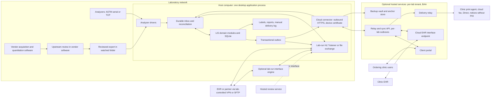

# Integration architecture and contract boundaries

Status: local ASTM, result-file and [AU400/AU640](au-protocol.md) interfaces are implemented and tested. Partner-exchange and hosted-service contracts are proposals ([ADR 0007](decisions/0007-integration-edge-and-interface-engines.md), [ADR 0010](decisions/0010-optional-cloud-services.md)). Source IDs resolve in [the domain](../research/sources-domain.md) and [engineering](../research/sources-engineering.md) registers.

The laboratory's host computer is the system of record. Integrations terminate either on that host (lab-run) or at optional hosted services (under a BAA), which relay to the host over an outbound-only link. Local drivers and listeners run inside the desktop application while it is open; any future connector follows the same lifecycle ([ADR 0009](decisions/0009-single-computer-local-lis.md)).

## Proposed topology

This diagram specifies future partner and hosted-service boundaries. The current application implements local ASTM/AU and result-file intake; it has no HL7 listener, portal, cloud connector or hosted delivery service.

The host computer initiates every connection to the cloud. No inbound port is opened to the internet. Analyzer TCP listeners and MLLP listeners bind only to the lab LAN ([technology research §1](../research/single-pc-technology.md#1-runtime-topology)). Instrument command, acquisition and peak integration remain in vendor systems. Worklist export is optional and only enabled where supported and validated.

| Exchange | Local path (lab-run) | Optional hosted path (under a BAA) | Requirements |
| --- | --- | --- | --- |
| Analyzer results and worklists | Analyzer drivers on the host: ASTM LIS1-A/LIS2-A2 over serial or TCP, watched-folder import | None; analyzer configuration and qualification are local deployment work | REQ-INT-005, REQ-INT-009 |
| Clinic orders | Staff enter phone, fax and paper orders; documented order-import format | Client portal as an ordering source | REQ-ORD-008–011 |
| EHR orders and results | HL7 v2 listener or file exchange on the host, optionally through a lab-run engine | Cloud EHR interface endpoint per clinic EHR | REQ-INT-001/002, REQ-INT-008 |
| Report delivery | Print, PDF, the lab's own fax or email, manual delivery log | Portal, clinic print agent, cloud fax, Direct, notices without PHI | REQ-RPT-011–014, REQ-SVC-009 |
| Backup and tamper-evidence anchors | Lab-owned targets, including write-once (Q-30) | Hosted vault and anchor store | REQ-OPS-007, REQ-SVC-004 |

**Integration edge.** The LIS owns the canonical order/result profiles, durable receipt, semantic acceptance and reconciliation. The edge that faces a partner is one of:

- the host's own lab-run listener or file exchange;
- a hosted EHR interface endpoint (optional), a qualified component under the lab's BAA;
- a laboratory-run interface engine in front of the host listener (optional, not bundled).

No edge acknowledgement, engine ACK or message-store entry counts as LIS acceptance. The LIS application outcome (accept, reject or error) must reach the partner, either passed through the edge or sent as a separate application acknowledgement or order response such as ORL^O22. Application-level auto-acknowledgement by any edge is not permitted. The host durably retains the original partner payload bytes before acknowledging receipt; edge retention is secondary. Contracts carry the partner control ID, the edge message ID (engine or cloud) and the LIS receipt ID, so counts reconcile across the extra hop.

No interface engine is bundled or selected. A future engine needs a named maintained release, confirmed advisory-fix status and license review. Its channels are versioned clinical mapping configuration; its message store belongs in the installation's PHI, retention and backup scope. [ADR 0007](decisions/0007-integration-edge-and-interface-engines.md) defines the clinical boundary independently of that selection.

Keep the clinical core independent of wire formats. Adapters map to explicit domain commands after authentication, validation and identity reconciliation. A syntactically valid message is untrusted input, not permission to edit a signed report or execute a clinical action. Documents/notes never supply agent instructions or configuration authority. The cloud never creates or changes clinical state (INV-14): everything it sends the host is a request or an evidence event.

## Relay and sync protocol

Proposed. The cloud connector in the host application is the only path between the host and the cloud services ([technology research §6](../research/single-pc-technology.md#6-local-to-cloud-connectivity), [ADR 0010](decisions/0010-optional-cloud-services.md)).

| Property | Proposal | Requirement |
| --- | --- | --- |
| Direction | Outbound HTTPS from the host only. Host-to-cloud items are POSTed from the local outbox; cloud-to-host items are pulled by long-poll, with WebSocket as an optimization. gRPC is not the first choice because HTTP/2 through lab proxies is unverified | REQ-SVC-001 |
| Device identity | Per-device X.509 client certificate (mutual TLS), key in the OS key store, hardware-backed and non-exportable where available. Enrollment by a one-time code issued to a lab administrator (WF-19) | REQ-SVC-001 |
| Fencing and revocation | The cloud accepts traffic only from the currently enrolled device for that lab. Re-enrollment, for example after restore to a replacement computer, revokes the previous certificate before the new device connects, so a stolen or recovered old host cannot dispatch | REQ-SVC-001, WF-19 |
| Envelope | Lab tenant ID, device ID, message ID (idempotency key), message type and schema version, per-stream sequence, payload digest, host-clock creation time and cloud-observed receive time | REQ-INT-003, REQ-INT-010 |
| Delivery semantics | Durable outboxes on both sides; at-least-once; deduplication by message ID; replay of a known key returns the stored first response; the same key with a different payload is an error. Report revisions are ordered per recipient | INV-04 |
| Host to cloud | Order receipts and decisions, released report versions and supersession status, clinic catalog subset, delivery jobs, audit anchor digests, backup job notices, PHI-free health heartbeat | ADR 0010 §3 |
| Cloud to host | Portal order requests and their versions, cancel and add-on requests, inbound EHR messages with original bytes, partner application acknowledgements, delivery outcome events, portal access and acknowledgement events | INV-14 |
| Clock | The host clock is the audit time source. The connector records server-observed skew on each exchange and alerts beyond a lab threshold | NFR-26 |
| Offline | Local work never waits on the cloud. Both sides show queue age; unsent items age into alerts | REQ-OPS-009, NFR-23 |
| Restore | After the host restores a snapshot older than its last sync, the cloud's record of receipts, released revisions it holds and delivery outcomes is input to reconciliation. Outbound dispatch stays fenced until externally issued revisions are reconciled (ADR 0005) | WF-18 |
| Publication | Protocol, envelope and payload schemas are published and versioned, so a lab or another provider can implement a compatible service. The license of server code is Q-11 | REQ-INT-010 |

The cloud holds only the data classes listed in [ADR 0010](decisions/0010-optional-cloud-services.md) (item 3), never unreleased results, QC, worklists or the full patient index (REQ-SVC-003).

## Client portal as an ordering source

Proposed; P0-conditional if the portal is in pilot scope. Basis: [cloud-services research §4.1](../research/cloud-services.md#41-client-ordering-portal) and [§5.1](../research/cloud-services.md#51-offline-queueing-and-acceptance).

### Portal order contract

A portal order is a request until the LIS accepts it. Its minimum meaning:

- lab tenant, clinic and location, and the clinic user who authored it (clinic-scoped, REQ-ORD-011);
- portal order ID, order version, content hash and the cloud receipt ID;
- the published catalog version the order was drafted against;
- patient as a clinic-scoped foreign identifier with demographics, insurance and billing responsibility as supplied (INV-02);
- ordering practitioner with NPI, and signature or intent-to-order attestation per order version;
- per-patient drug class or analyte selections and method certainty, reflex authorization, and a flag when a clinic-authored template was applied unchanged (REQ-ORD-006, REQ-ORD-010);
- diagnoses as supplied, medication statements with as-of date, and clinic point-of-care results as attributed context (INV-13);
- patient-specific standing-order reference, collection date and time, collector observations;
- for cancel and add-on: the target order and version, and the request ID.

The portal has no default selections or prepopulation. Missing payer documentation is a non-blocking prompt that becomes a billing review item at the lab; missing order-authority elements follow the order policy's clarification hold (REQ-ORD-010, REQ-ORD-005). The portal does not label orders medically necessary and does not apply payer frequency rules.

### Receipt states

| State | Set by | Evidence | Clinic sees |
| --- | --- | --- | --- |
| Received by portal | Cloud portal | Cloud receipt ID, order version hash, receive time | "Received by portal. Not yet confirmed by the lab." plus the lab's last-contact time |
| Received by lab | LIS, after committing the order to its durable inbox | LIS receipt ID returned to the cloud | "Received by the lab system." |
| Accepted, clarification hold, or rejected | LIS semantic decision (order policy, catalog version, identity) | Decision, reason, decider and time | Accepted, the question the lab needs answered, or the rejection reason |
| Later states | LIS (specimen received, resulted, corrected, withdrawn) | Accession, receipt time, report revision ID | Status with prior-revision link |

Only "received by lab" and later states come from the LIS. "Received by portal" is a transport and storage fact (REQ-INT-002). Cancel and add-on are shown as "requested" until the LIS decides; a cancel racing a result never erases an issued report (REQ-ORD-002).

### Offline queueing and redelivery

1. The cloud assigns the receipt ID and version hash and queues the order for the lab's enrolled device. The clinic is told it is received by the portal, never that the lab accepted it.
2. When the host is online, the connector pulls queued items, the LIS commits them to its durable inbox, and only then returns the LIS receipt ID.
3. The LIS applies semantic checks and returns its decision as a separate message.
4. A lost acknowledgement causes redelivery with the same idempotency key. Same order ID, version and content reconciles once. Same ID and version with different content is a conflict; a new version is a change request, never an overwrite of accepted evidence (REQ-INT-003).
5. An order unretrieved past a lab-configured limit becomes an owned exception in the cloud and an alert to lab contacts (WF-16). Clinics can still print the requisition and collect.

### Specimen before order

The requisition printed at the clinic is self-sufficient (REQ-ORD-009). It carries the portal order ID and version, a barcode, patient identifiers, ordering practitioner and NPI, selections and method certainty, diagnoses as supplied, medications with as-of date, signature indicator and collection data.

- **Host online:** scanning the requisition barcode makes the connector fetch that order version; accessioning proceeds against the received order.
- **Host offline or cloud unreachable:** staff enter the order from the requisition under the downtime procedure (WF-10). The scanned requisition is the source artifact.
- **Reconciliation:** when the cloud order later arrives, the LIS matches it by portal order ID and version. Agreement reconciles once; any difference becomes a conflict for review, never a silent overwrite of the manually entered order.

## HL7 v2 contracts

The proposed first EHR pathway uses a partner-negotiated HL7 v2 profile, commonly based on 2.5.1 where the counterpart supports it. The following are actual standard messages, not a promise that all partners support all of them. Base-standard ordering defines OML^O21 with ORL^O22 response; ORM^O01/ORR^O02 remain compatibility forms. ORU^R01 carries observation reporting. [DOM-007](https://www.hl7.eu/HL7v2x/v251/std251/ch04.html), [DOM-008](https://www.hl7.eu/HL7v2x/v251/std251/ch07.html)

| Exchange | Candidate negotiated message | Contract must resolve |
| --- | --- | --- |
| Laboratory orders | OML^O21 and ORL^O22; alternatively legacy ORM^O01 and ORR^O02 | Placer/filler authority, order-control actions, specimen/container grouping, requested tests, AOEs, cancellations, duplicates and application response. OML^O33/O35 variants only if explicitly required and tested. For drug monitoring, the profile states how each of the following is carried: • diagnoses (DG1, as supplied, never defaulted) • the ordering practitioner's NPI and assigning authority (ORC-12/OBR-16) • per-patient drug/class selections (individual order codes or AOE answers, not a panel name alone) • standing-order or profile use • medication statements (AOE or an agreed segment, with received text preserved) • clinic point-of-care results, kept as attributed context and never imported as laboratory observations  Elements a partner cannot carry go to the requisition/manual route or, where the lab uses the portal, to a portal task for the clinic to complete; the order stays on clarification hold until supplied (REQ-ORD-005/007). |
| Laboratory results | ORU^R01 plus agreed ACK behavior | OBR/OBX grouping, result identifiers/sub-IDs, value types, units, report/component statuses, comments, partial/final/corrected handling and original order correlation. Not-tested entries, validity qualifiers and remote-review location codes (REG-037) follow the approved report content. Medication-consistency annotations are separate coded observations with their own identifiers, rule version and medication snapshot reference. They are never merged into, or used to modify, analytical OBX values; free-text NTE is a fallback only where the partner cannot carry coded observations. |
| Demographic updates | Explicit partner ADT profile if required, such as A08 update and A40 merge | Merge authority, identifier domains, unmerge/incorrect-merge handling, effect on already issued reports. Do not accept automatic global identity merges solely because an ADT arrived. |
| Financial handoff | Partner-defined service export; DFT^P03 only if counterpart agrees | Charge identity, date of service and its rule version, adjustments/reversals, coding license and acknowledgements. Classes ordered, performed and reported per specimen. Class-mapping, code-set and derivation versions with input component references. Orderer NPI and enrollment-check reference, billing NPI/TIN (REG-034), diagnoses as supplied, payer-policy references and derivation flags. A DFT feed is not a claims adjudication system. |
| Public-health reporting (conditional) | HL7 v2.5.1 ELR per jurisdiction onboarding, or a controlled manual route | Enabled only when the menu includes jurisdiction-reportable results, such as blood lead, in states where the lab operates (REG-041). Triggered by approved PublicHealthReportingRuleVersion criteria, never by drug name alone. Durable submission, acknowledgement and reconciliation (REQ-INT-002). Routing through a hosted endpoint makes its provider a business associate for that flow ([§15.7](../research/regulatory-landscape.md#157-secure-delivery-interoperability-and-public-health-reporting)). [SR-094/095](../research/sources-regulatory.md) |

The ADT and DFT candidates identify future contract scope; their full profiles have not been reviewed for this project. They must not be enabled based on this table alone. HL7's LOI product brief documents a US ambulatory ordering guide family; reviewing the brief is not reviewing or conforming to the complete guide. [DOM-009](https://dev3.hl7.org/implement/standards/product_brief.cfm?product_id=152)

Edition status at the 2026-10-12 check:

- **LOI and LRI:** the current US guides are Edition 5, both STU. LRI Edition 5 superseded the expired Release 1 STU Release 4. ASTP's standards pages still cite the older releases, and some partners will too.
- **eDOS:** retired, with a FHIR Order Catalog guide as the stated direction. Its STU/FHIR-version details were not confirmed from the cited brief.

The proposed canonical inbound profile derives from LOI Edition 5 and the outbound profile from LRI Edition 5. Both apply unchanged whether the edge is the host listener or the cloud endpoint. The interface contract records which edition and which deviations each partner actually uses. The licensed guides themselves have not been reviewed. [ENG-27–29](../research/sources-engineering.md)

Every contract specifies MSH sending/receiving application/facility, character set/escaping, version/profile, timezone and timestamp precision, MSH-10 control-ID uniqueness, patient and order assigning authorities, required fields, code systems, allowable value forms, OBX-11/OBR-25 status combinations and correction semantics. Quantitative comparators require an agreed representable form such as a supported structured numeric value; never emit a censored bound as an exact NM value. Recipient systems must demonstrate that corrections supersede the intended prior observation/report rather than creating a second unrelated result.

MLLP is framing over a connection, not encryption or authorization. On the local path, the host's MLLP listener binds to the lab LAN only. A partner outside the lab network reaches it through a lab-controlled VPN, or exchanges files over SFTP that the host connects to outbound; never by exposing the listener to the internet. The cloud endpoint uses authenticated TLS or a managed private tunnel per partner. Validate endpoint identity and isolate every partner's credentials and routes. A partner that only supports a legacy transport requires an explicit controlled boundary.

HL7 distinguishes original and enhanced acknowledgement modes; MSH-15/MSH-16 control acknowledgement expectations, and commit acceptance differs from application acceptance. Proposed processing records each stage separately. An ACK code never proves that a clinician has seen the report, and its exact durability/validation meaning must be agreed. [DOM-006](https://www.hl7.eu/HL7v2x/v251/std251/ch02.html)

### Cloud EHR interface endpoint: acknowledgement split

Proposed (REQ-INT-008, P0-conditional). With the optional external route, the clinic EHR connects to the hosted endpoint, not to the host ([cloud-services research §4.2](../research/cloud-services.md#design-for-a-cloud-operated-interface-endpoint)).

| Stage | Who | Meaning | Never means |
| --- | --- | --- | --- |
| Commit acknowledgement | Cloud endpoint | The original bytes are durably stored in the lab's tenant | LIS receipt or acceptance |
| LIS durable receipt | Host, after committing the original bytes and a receipt record | The lab's system of record holds the message | Semantic acceptance |
| Application decision | LIS | Accepted, clarification hold, rejected or error, with reason | Clinical review or result |
| Application response to partner | LIS outbox via relay and endpoint | ORL^O22 (or the negotiated order response or application ACK) carrying the LIS decision | Recipient clinician action |

Rules:

- The endpoint never generates application-level acceptance. It holds the original bytes until the host confirms durable receipt, plus a reconciliation window, then deletes them per retention; the host keeps them.
- Partner tolerance for an asynchronous application response is unknown per EHR. Some may treat the commit ACK as final or time out. The contract records the partner's acknowledgement mode and tested behavior:

| Partner behavior | Endpoint behavior |
| --- | --- |
| Enhanced mode: accepts a commit ACK, then a later application response | Proposed baseline |
| Original mode, accepts a later ORL^O22 as the order decision | Negotiate in writing that the immediate ACK means durable receipt only; test that a later rejection is displayed |
| Requires a synchronous application ACK | Hold the connection for the LIS decision only while the host is online and within the partner timeout; otherwise return an error, never "AA". If unworkable, use the portal or manual route for that partner |

- Outbound results go from the host outbox through the relay to the endpoint as ORU^R01. The partner's ACK returns to the host as delivery evidence at the level it actually proves.
- Correlation carries the partner MSH-10, the cloud message ID and the LIS receipt ID. Reconciliation compares partner, cloud and LIS counts.

## HL7 FHIR R4 boundary

FHIR R4 (4.0.1) is a proposed compatibility target for future interfaces, not a claim that it is the newest FHIR release. For US partners, profile against US Core:

- **6.1.0 / USCDI v3:** the certification baseline that certified EHRs must support.
- **9.0.0 / USCDI v6:** current, and approved under the 2026 SVAP.

Use the Laboratory Result Observation, DiagnosticReport for Laboratory Results Reporting, Specimen and ServiceRequest profiles. Negotiate the version per partner, because certified EHRs advance at different rates. USCDI v7 (July 2026) adds specimen collection method and collection date/time, which the domain model already preserves. [ENG-32–34](../research/sources-engineering.md) The internal model remains tailored to laboratory operations. Published capabilities, partner profiles and accepted operations constrain what the interface exposes.

| Concept | Candidate R4 representation | Boundary |
| --- | --- | --- |
| Test request | ServiceRequest | Authorized request/context, not an instrument worklist or unrestricted command to start testing. [DOM-010](https://www.hl7.org/fhir/R4/servicerequest.html) |
| Biological specimen | Specimen | Collection and derivation information; internal container/location/custody history needs additional governed representation. [DOM-011](https://www.hl7.org/fhir/R4/specimen.html) |
| Atomic result | Observation | Value, comparator/units where applicable, status, method, absence reason and specimen linkage; do not flatten all interpretations into abnormal flags. [DOM-012](https://www.hl7.org/fhir/R4/observation.html) |
| Issued report | DiagnosticReport referencing Observations, with issued artifact in presentedForm when supported | Report grouping/status and the actual issued representation; proprietary raw spectra belong in governed artifact storage. [DOM-013](https://www.hl7.org/fhir/R4/diagnosticreport.html) |

Patient, Practitioner, Organization and Provenance references need partner profiles and ownership rules. AuditEvent/Provenance exports may supplement, but do not replace, the internal audit and chain-of-evidence records. FHIR history/version IDs represent resource versions, which must be mapped deliberately to the LIS report/release model; not every resource update is a newly issued clinical report.

Declare supported resources/searches and write operations in a CapabilityStatement. Use conditional creation or version-aware updates only when both ends support their exact semantics; otherwise enforce equivalent idempotency and stale-version protection at the adapter. Demonstrate the recipient's version/correction behavior. R4 defines versioning and conditional interactions but does not require every server to support them. [DOM-014](https://www.hl7.org/fhir/R4/http.html)

FHIR decimal values use JSON numbers, and their precision requires lossless handling through parsers and serializers. Keep the private UI–engine decimal contract distinct from the FHIR wire profile; do not silently quote FHIR numbers or route them through a parser that discards significant precision. Contract tests must include trailing zeros and values beyond a binary float's exact representation. [ENG-17](https://www.hl7.org/fhir/R4/json.html)

Initial partner acceptance must cover authentication, patient matching, ordered versus resulted codes, partial/final/corrected reports, absent/censored results, timezone precision, authorization and error responses. A generic FHIR validator passing a resource proves neither clinical completeness nor partner workflow compatibility.

## Terminology and numeric semantics

Maintain a local canonical test/analyte catalog and separate versioned mappings to each partner. LOINC selection considers component, property, timing, specimen system, scale and method; string similarity is insufficient. Keep orderable panel codes and reportable analyte codes distinct. Unmapped local concepts can remain local under an explicitly agreed contract; do not invent a LOINC code or claim semantic equivalence. [DOM-016](https://loinc.org/kb/users-guide/major-parts-of-a-loinc-term)

Record the local concept/version, external code/system/version, mapping relation, reviewer, effective period, matrix/method restrictions and approval evidence. Retired or changed terminology prompts review; historical messages retain the original mapping and local meaning. A mapping fix for an affected result is a controlled correction, not bulk reinterpretation of all stored data.

Current terminology releases change on different schedules:

- **SNOMED CT US Edition:** March and September.
- **RxNorm:** monthly, with weekly updates; used for optional medication-statement coding.
- **UCUM:** 2.2.
- **LOINC:** a 2.83 release with drug/toxicology method changes is reported but was not verified.

Mappings therefore record the terminology version, and a terminology update starts mapping review rather than an automatic remap.

- **LIVD:** covers vendor-defined IVD tests. Its FHIR guide is still a ballot. It may help map purchased immunoassay screens but does not cover in-house LC-MS/MS methods, which need laboratory-owned LOINC mapping.
- **SHIELD:** remains an FDA harmonization program, not a conformance target.

[ENG-30/31/39](../research/sources-engineering.md)

Use case-sensitive UCUM machine codes separately from display labels where applicable. Preserve source value/unit and approved normalized representation; reject unsupported or dimensionally incompatible conversion. Numerical formatting, comparator bounds and assay thresholds remain explicit domain values. UCUM defines unit expressions; it does not define the laboratory's reporting precision or clinical interchangeability. [DOM-018](https://ucum.org/ucum)

LOINC and UCUM have distinct license conditions even when the application is open source. Keep licensed terminology data, third-party code sets and vendor format documents outside a blanket repository-license assumption; preserve required notices and review redistribution rights. FHIR's CC0 terms do not automatically license third-party vocabularies or HL7 v2 publications. [DOM-017](https://loinc.org/license/), [DOM-019](https://ucum.org/license), [DOM-015](https://hl7.org/fhir/R4/license.html)

## Analyzer drivers on the host computer

The analyzer drivers run in the application process while it is open, including while it shows its sign-in screen with nobody signed in. They stop when the app closes or the OS signs out, reboots or updates; ASTM retransmission, durable receipts and expected-result reconciliation at the next start cover the gap ([ADR 0009](decisions/0009-single-computer-local-lis.md#consequences)).

Driver types (REQ-INT-009, P0):

- **ASTM LIS1-A (framing) and LIS2-A2 (records)** over serial and TCP. In-house code, because no maintained open-source driver exists ([ENG-82](../research/sources-engineering.md#single-computer-technology-sources)). The driver sends the low-level ACK for a frame or message only after the received content is durably committed. It has a conformance corpus with synthetic sessions, including checksum errors, timeouts, contention, interrupted transfers and duplicate retransmission. AU400/AU640 sessions follow the [AU contract](au-protocol.md).
- **Watched-folder import** for delimited vendor quantitation exports; XML and other unsupported shapes are not parsed. The folder may be local or a lab-LAN share on a vendor workstation; the database never is. Placing any software on an instrument control workstation requires vendor/support review. Contract: [result-file intake](../planning/result-files-design-brief.md), with manual loading by the same path.
- **HL7 from instrument software** (for example MassLynx), proposed: through the host's lab-LAN listener, under the same contract rules as partner HL7. No HL7 listener is implemented.

Official documentation demonstrates several routes: SCIEX describes a MultiQuant template producing CSV, Waters documents a MassLynx interface sending HL7 using configured assays/templates, and MassLynx 4.2 documents text/XML export. These are product/version-specific routes requiring installed-license and laboratory validation checks. The SCIEX article is explicitly research-use-only. [DOM-020](https://sciex.com/support/knowledge-base-articles/how-to-interface-multiquant-with-lims-system-via-lims-report-template_en_us), [DOM-021](https://help.waters.com/content/dam/waters/ko/support/usermanuals/2024/715008798/715008798.pdf), [DOM-022](https://help.waters.com/content/dam/waters/en/support/usermanuals/2006/71500123505/71500123505v01.pdf)

| Driver responsibility | Proposed requirement |
| --- | --- |
| Acquisition boundary | Read supported exports after vendor processing/review, or receive ASTM result records the analyzer emits. Do not reverse-engineer proprietary raw formats or replace validated acquisition/integration software in initial scope. |
| Upstream review layer | Register the quantitation/review system, version and export template. Import batch-level processing revisions with upstream review attestations (human or rule-based, reviewer as asserted, state, rule-set version). Apply the re-export rules in the [domain model](domain-model.md#upstream-analytical-review-and-re-export). A hosted review service is a partner interface with its own credentials, agreement and reconciliation; it reaches the host through the lab-run listener or file exchange, or through an enabled hosted service. [ENG-60–62](../research/sources-engineering.md) |
| Provenance | Bind file/message checksum, instrument, software/build, method, run, position, sample/aliquot ID, analyte, unit, flags, processing revision, export-template or ASTM session identity, and driver version. Flag fields not available in the vendor format. |
| Worklists | If supported, export or send (ASTM order records) only authorized expected sample IDs/positions/methods; validate return mapping against the approved worklist; never infer identities from row order alone. Do not change instrument parameters ([§15.6](../research/regulatory-landscape.md#156-fda-boundary-for-lis-middleware-and-portals-guidance-statutory-exclusion)). |
| File completion | Detect complete stable files using the supported export protocol; avoid ingesting partially written files; preserve source bytes before parsing. |
| Durability | Commit source bytes and receipt to the host's content-addressed artifact store and inbox before any ACK, move or rename of the source. Bounded retry/backoff, capacity alarms on the host disk, explicit backpressure; no silent eviction of unacknowledged evidence. Retain payload and receipt evidence until an independently verified backup snapshot covers it, plus the approved replay/reconciliation window. An ACK alone does not authorize purging the last recoverable source. |
| Isolation | Drivers run inside the application under its standard OS account (on Linux, in the `dialout` group for serial ports). Analyzer TCP listeners bind to the lab LAN only. Serial and folder access are limited to configured ports and paths. |
| Recovery | Replay with original IDs and frozen mapping/version; after a restore that predates acknowledged input, reconcile against analyzer or vendor-side retained output and source files. Retain deduplication across restarts and restore; surface unreconciled evidence before reopening release. |
| Manual fallback | Controlled upload/entry with source evidence, attestation by the entering staff member and required independent verification under SOP; no arbitrary spreadsheet edits replacing source results. |

An adapter compatibility record must name instrument/model, vendor software/build, acquisition/processing methods, export route/template or ASTM dialect, operating system, supported fields, known omissions, vendor permissions and accepted synthetic fixtures. There is no universal plug-and-play analyzer connector commitment. A vendor upgrade, changed method/export template or decimal formatting change requires an impact assessment and appropriate revalidation. Analyzer drivers are part of the free LIS; each connection still requires laboratory-approved configuration and qualification.

## Conceptual exchange contracts

These are contract checklists, not serialized schemas or executable examples.

| Contract | Minimum meaning |
| --- | --- |
| Order received | Sending partner or portal and business order ID, idempotency identity, cloud receipt ID when relayed, patient/source identity, order items/catalog versions and expected components, authorization, specimen context, source time/precision and recipient intent; change/cancel request identity and accepted outcome are distinct. |
| Portal order request | See [portal order contract](#portal-order-contract). |
| Instrument result imported | Source/run/processing revision and export sequence or ASTM session, upstream review system/version and attestation state (human or automated), exact material/execution/analyte references, original value/unit/flags, calibrator/control rows kept separate from patient rows, artifact hash, driver/mapping version, expected-versus-received reconciliation, partial-export scope and quarantine reasons. |
| Report released | Immutable report/revision identity, patient/specimen/performer snapshot, selected result revisions and component dispositions, publication/completeness/amendment status mapping, prior-revision relationship, signatory/time and recipient obligations. |
| Report delivery receipt | Destination/contract version, channel, report revision, attempt/correlation IDs (including cloud job ID), transport outcome, application outcome, evidence level and signal source, observed time and remaining reconciliation obligations. Never a bare "delivered" (INV-15). |
| Relay envelope | See [relay and sync protocol](#relay-and-sync-protocol). |
| Performed service handoff | Stable service identity, authorized/performed item and date of service, specimen/order linkage, referral/repeat/cancellation disposition, drug classes ordered, performed and reported with mapping, code-set and derivation versions and input component references, ordering-source diagnoses and medical-necessity evidence references, billing code/version only when approved and adjustment relationship. |
| EHI export package | Uses the domain EvidencePackage mechanism. Patient (or installation) scope, record classes included per designated-record-set inventory, structured data with data dictionary and terminology versions, exact issued report artifacts, generation time and requester authority. |

All boundaries define authentication/authorization, payload limits, validation errors, retention class, audit events, operational owner and replay procedures. Source artifacts must be protected as sensitive laboratory records and must not leak into application logs, crash traces, telemetry, support bundles, public issues or AI prompts. Telemetry and support bundles are PHI-free by default (REQ-SVC-003).

Where the privacy-approved applicability assessment identifies a consent-based Part 2 disclosure, the delivery package must carry the required written notice and a copy of the consent or clear explanation of its scope. Record the accompanying notice/consent-scope versions and actual recipient with the disclosure evidence. A results, referral or billing destination that cannot receive the required accompanying material needs an approved alternate route or an actionable disclosure hold; a successful clinical payload ACK does not satisfy that obligation. Do not infer Part 2 coverage from a drug result alone. [REG-019 / SR-039: 42 CFR 2.32](https://www.ecfr.gov/current/title-42/chapter-I/subchapter-A/part-2/subpart-C/section-2.32), [regulatory source register](../research/sources-regulatory.md)

## Delivery evidence per channel

REQ-RPT-011, INV-15. Local manual delivery records are implemented with staff-attested *handed off*, *failed* and *outcome unknown* evidence; the other evidence levels and the hosted channels are proposed. Every delivery record names the channel, the signal source and the evidence level reached. A bare "delivered" is never shown in the UI, a report or an export. Missing confirmation past the channel's limit is "outcome unknown" and goes to reconciliation. Urgent results are confirmed by the lab's phone read-back process (REQ-RPT-004), never by a digital signal. Evidence and sources: [cloud-services research §6](../research/cloud-services.md#6-delivery-channel-confirmation).

Evidence levels, weakest to strongest (proposal): *queued*; *handed off* (to a provider or printer queue); *transport complete* (provider-defined); *custody at receiving system*; *accepted by recipient system*; *recipient access*; *recipient acknowledgement*. Terminal negative states: *failed* (with reason) and *outcome unknown*.

| Channel | Path | Labels the record may show | Highest level reachable | Does not prove |
| --- | --- | --- | --- | --- |
| Manual print, PDF, lab's own fax or email | Local | "Printed by [user]", "PDF exported by [user]", "Faxed by staff (attested)", "Handed to courier" | Handed off (attested) | Receipt by anyone |
| Lab-run HL7 listener or engine | Local | "Partner commit ACK", "Accepted by recipient system", "Rejected by recipient system" | Accepted by recipient system | Chart filing or clinician review |
| Client portal | Optional external service | "Available in portal", "Viewed by [clinic user]", "Downloaded by [clinic user]", "Acknowledged by [clinician]" | Recipient access; recipient acknowledgement only if the clinician acknowledges | Reading or understanding; a shared login weakens it |
| HL7 via cloud endpoint | Optional external service | "Stored by hosted endpoint", "Accepted by recipient system", "Rejected by recipient system" | Accepted by recipient system | That an immediate "AA" came from a validating system; clinician review |
| Clinic print agent | Optional external service | "Print job handed to printer", "Print server reports job completed" | Handed off | Paper printed, collected or attached to the right tube |
| Cloud fax | Optional external service | "Fax provider reports transmitted", "Fax provider reports failed: [reason]" | Transport complete (provider-defined) | Right number, right person, remote-device confirmation |
| Direct (HISP) | Optional external service | "Receiving HISP processed", "HISP dispatched notification received" | Custody at receiving system | Clinician access; behavior is HISP-dependent |
| Email or SMS notice | Optional external service | "Notice accepted by mail server", "Notice accepted by carrier" | Notice only; carries no PHI and no report | That the report was retrieved |

Destination verification (REQ-RPT-012): a new fax number or Direct address is verified by a lab administrator before the first PHI delivery, and every change is audited. Before every dispatch the system rechecks the destination's current authority and report restrictions.

Under CLIA the portal, relay and each interface are part of the lab's delivery chain. Besides per-destination evidence, the lab runs a periodic check that received content matches what was sent ([§15.4](../research/regulatory-landscape.md#154-clia-with-one-pc-as-the-laboratorys-record-system), REG-047).

## Correction propagation to caches and destinations

REQ-RPT-013. Local delivery obligations for corrected revisions are implemented ([overview](overview.md#transaction-and-failure-design)); propagation to caches and automated destinations is proposed. A corrected, supplemented or withdrawn report is a new report revision in the LIS. The release transaction creates one obligation per destination that received an earlier revision, and one supersession-status message per cloud cache ([§5.2](../research/cloud-services.md#52-correction-propagation)).

| Destination | Propagation | Evidence and limits |
| --- | --- | --- |
| Portal cache | The supersession status travels ahead of new content. The cloud marks the cached report "revision pending" or "withdrawn" as soon as it arrives, then shows the new revision as current with prior revisions retained and labeled; a notice without PHI goes to the clinic | Clinic access logs show who viewed which revision |
| EHR (HL7 v2), either path | ORU^R01 with corrected status on the same filler order identity | Per-partner proof that it supersedes rather than duplicates |
| EHR (FHIR, later) | Version-aware DiagnosticReport update where supported | Version semantics demonstrated per partner |
| Fax, Direct, print agent, manual | New document labeled as corrected, referencing the prior revision | An earlier fax cannot be recalled; the obligation is notification |
| Wrong patient | Minimal withdrawal notice to the original destination; separate authorized disclosure for the correct patient | REQ-RPT-002, WF-08 |

The cloud can only learn of a correction when the host is online. While the host is offline, the portal shows each report's last-confirmed sync time, and the downtime procedure covers phone or fax notification of urgent withdrawals. Whether lab staff may suspend a cached report's visibility directly in the portal while the host is offline (an access restriction, not a clinical change) is an open design point.

## Reconciliation reports per channel

Proposed. Each channel has an owned report with counts and an identity-level exception list; ageing is visible (REQ-OPS-004). Detail: [§5.3](../research/cloud-services.md#53-reconciliation-reports-per-channel).

| Channel | Counts compared | Exceptions listed |
| --- | --- | --- |
| Portal orders | Received by portal, received by lab, accepted, held, rejected, cancelled | Unretrieved past limit, LIS rejects, version conflicts, manual entries awaiting their cloud order |
| Portal results | Released versus available in the portal; corrections pending | Released but not visible; stale or revision-pending items |
| HL7 inbound (either path) | Partner control IDs received, edge-stored, LIS-received, application-accepted | Unmatched control IDs, rejects, duplicates |
| HL7 outbound (either path) | Revisions emitted, sent, commit-acknowledged, application-accepted | Unknown outcome, negative acknowledgement |
| Fax, Direct, print agent, notices | Jobs by evidence level and failure reason | Failed, unconfirmed, repeated failures per destination, agents offline |
| Analyzer drivers | Expected versus received samples and analytes per run; sessions and files | Unknown sample IDs, partial runs, quarantined files |
| Relay | Outbox depth and oldest age on both sides; last sync | Items past age limits; fencing rejections |

## Patient access, EHI export and information blocking

An independent laboratory is likely an information-blocking actor. It counts as a health care provider, and EHI covers ePHI in the designated record set, which includes billing as well as medical records. Current HHS provider disincentives do not list laboratories, but actor obligations still apply. An uncertified LIS developer is not itself an actor. HTI-5's information-blocking changes remain proposed. Applicability belongs to REG-016 owners. [ENG-35–38](../research/sources-engineering.md), [SR-017](../research/sources-regulatory.md), [SR-036](../research/sources-regulatory.md)

Proposed architecture:

- **Designated-record-set inventory.** Map every record class to inclusion or exclusion with privacy approval: orders, results, reports, corrections, billing handoffs, medications and diagnoses, delivery history. Whether cloud-held copies belong to the designated record set is Q-15.
- **Per-patient EHI export.** A machine-readable export of all included classes, generated by the application on the host. Use US Core–aligned FHIR R4 where a mapping exists, plus documented NDJSON/CSV with a data dictionary for local concepts. Include the exact issued report artifacts. Withhold or redact only under recorded, attributable exception decisions such as Part 2 or a privacy determination.
- **Installation-wide export.** The same package format serves exit and migration (NFR-12, REQ-OPS-010). Cloud-held data has its own export (REQ-SVC-005).
- **Timeliness.** Released results reach authorized EHR and patient-access routes without a configured blanket delay. Any hold uses a documented exception with an owner and expiry. CLIA permits labs to give completed reports to patients on request ([SR-008](../research/sources-regulatory.md)). Until a patient portal exists (REQ-SVC-010, Q-35), patient access is the manual route (REQ-RPT-009).

The certified EHI-export criterion is proposed to remain unchanged under HTI-5. Aligning with its intent is a portability goal, not a certification claim. [ENG-37](../research/sources-engineering.md)

## Idempotency and reconciliation

1. Allocate a durable inbox record per scoped source identity before processing. Pair source keys with a content hash: same key/same content reconciles once; same key/different content is a versioned change or explicit conflict. This applies equally to analyzer sessions, listener messages and relayed cloud items.
2. Distinguish an envelope ID from its clinical business identity. A sender can assign a new message ID to a duplicate order, and a correction may reuse the original observation identifier intentionally. A relay message ID is an envelope ID too.
3. Enforce domain revision/order constraints. Delayed preliminary data cannot replace a final/corrected observation; stale updates go to review when the partner cannot provide reliable ordering.
4. Commit result/report changes and outgoing obligations together in the same SQLite write transaction. Workers deliver at least once with stable destination/report-version keys; external exactly-once delivery is not assumed. Lease expiry cannot prove that the prior worker stopped or that the destination rejected its request.
5. Retry transient transport failures with bounds; quarantine semantic failures. Preserve original data and approved mapping version during replay unless a reviewed remediation intentionally changes the interpretation.
6. Reconcile counts and identities for expected orders, samples, run positions, analytes, report revisions and performed services. A healthy connection is not evidence of complete work.

### Report ordering and uncertain outcomes

Maintain a destination-specific revision chain and one authorized progression through that chain. A timed-out request may have been applied remotely: record an **outcome unknown** state, query/reconcile when supported and use the partner's demonstrated idempotency/version checks before retry. If the destination has no dependable ordering/deduplication support, require controlled sequential dispatch and a manual reconciliation/escalation path; expiring a local worker lease is insufficient proof that an earlier request cannot still arrive. Do not let a delayed partial/original report replace a later final/corrected report in the recipient's current view.

The contract determines whether all revisions must be delivered or an untransmitted earlier version can be superseded by a later complete one. Any superseded obligation retains its reason and relationship; do not silently delete it or assume an earlier in-flight revision was never seen. Structured messages and rendered documents must identify the same issued revision and component dispositions. A mapping/format repair may change an envelope under a reviewed adapter revision without changing clinical content; if the clinical meaning changes, use the report-correction workflow.

Before every dispatch, recheck current destination authority and current report restrictions. Prior delivery creates a notification/reconciliation duty, not unconditional permission to resend clinical contents. Wrong-person corrections require privacy/quality review of a minimal withdrawal/correction notice; the correctly identified patient's additional information must not be sent to the wrong original recipient. Preserve attempts, actual destinations, acknowledgements and manual contacts for every revision.

### Orders, identity and late evidence

Stage ADT identity updates and order changes against their own assigning authority, current association and expected revision. Conflicting merges, unmerges and corrected external identifiers require an attributable resolution and impact inventory across released reports and outbound routes. Do not automatically move all results to a newly asserted patient or broaden client access through a merge. A portal patient ID is a foreign identifier scoped to the clinic; the LIS never auto-merges on it.

A cancellation message is a request until the authoritative order workflow accepts it. Preserve late instrument/referral output after cancellation as source evidence and reconcile its disposition; receipt alone does not reinstate the order, release a result or generate a charge. Adapter replay must recheck present domain guards while preserving the original payload and historical mapping context. A clinically invalid replay ends in an actionable exception rather than bypassing controls to reproduce a former successful transport response.

## Per-partner readiness evidence

Before an interface is called supported, obtain its actual guide and software version; secure access/contract/licensing terms; laboratory-approved mapping; normal, duplicate, conflict, censored, missing, partial, corrected, cancelled and out-of-order fixtures; restart/outage/replay and unknown-outcome evidence; recipient rendering comparison; runbook and named ownership. Include recipient revocation and wrong-person correction. For the cloud endpoint, also show the partner's handling of commit-only acknowledgement and a later application rejection, and an offline-host day followed by catch-up. Synthetic file and message fixtures support development and demos; none is a production-ready partner contract.

The readiness record per EHR (extends REQ-INT-001) names the partner's program, LOI/LRI edition, supported messages, acknowledgement mode and tolerance, correction semantics, route (lab-run or hosted endpoint), who is charged and the measured onboarding time. Public evidence leaves most of this unknown ([cloud-services research §4.2](../research/cloud-services.md#partner-onboarding-and-interface-qualification), Q-05):

| Unknown | What public sources show | Consequence |
| --- | --- | --- |
| Onboarding timeline | No EHR publishes one | Assume weeks to months and measure with design partners; the portal is the route that does not wait on an EHR queue |
| EHR and laboratory-connectivity hubs | One build may reach many clinics of one EHR | Unknown whether hubs carry individualized toxicology order content and corrected results |
| Asynchronous application response | Not documented | Test per partner ([acknowledgement split](#cloud-ehr-interface-endpoint-acknowledgement-split)) |

Fraud-and-abuse constraint (Q-32, REG-045/046): an interface or portal access furnished free to a clinic must serve only the furnishing lab's orders and results. In the OIG opinion relied on, clinics paid for their own EHR, hardware and connectivity. Whether the laboratory or a service provider may ever pay a clinic's EHR-vendor interface or connection fees, or furnish clinic hardware not limited to the lab's work, is a counsel decision required before the first EHR interface is offered. Access is never offered or withheld by a clinic's expected order volume or payer mix, and the LIS records what is furnished to each clinic (REQ-ORD-011, REQ-BIL-003, REG-032). See [regulatory landscape §15.5](../research/regulatory-landscape.md#155-fraud-and-abuse-laboratory-furnished-clinic-portals).
