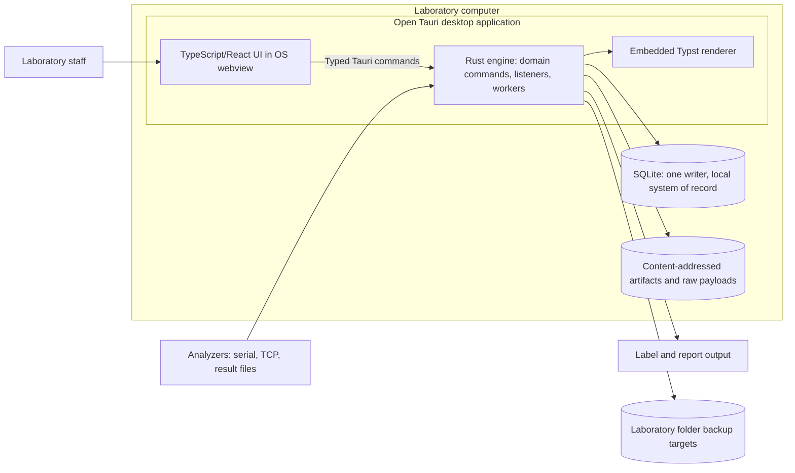

# System architecture

This overview describes the local application and its safety contracts. The [project scope](../project-scope.md#product-decision) defines the product; [ADR 0009](decisions/0009-single-computer-local-lis.md) and [ADR 0012](decisions/0012-rust-tauri-desktop-application.md) define the application form and stack. The [decision index](decisions/README.md) records each ADR's status; implementation alone does not accept an open proposal. [Release readiness](../quality/open-items-g1-g2.md) records unresolved qualification work.

## Local application

One application process contains the engine, analyzer listeners and durable workers. The TypeScript/React UI renders in the operating system's webview and calls thin Tauri commands. There is no UI web server or background LIS service. Listeners run only while the application is open, including at its sign-in screen; native sleep prevention, single-instance controls and close/startup behavior require per-OS qualification.

The engine owns a local SQLite database with one writer, read connections, an append-only audit chain, transactional outbox rows and content-addressed artifacts. It receives ASTM/AU analyzer data and approved delimited result files, renders reports with embedded Typst, sends ZPL through TCP or CUPS, and creates encrypted full backups to configured folder targets. The [implementation plan](../planning/implementation-plan.md#status) and [operator guide](../operations/README.md) describe the supported workflows and limits.

The UI has no direct database or artifact-store authority. Analyzer listeners belong on the laboratory network; the application does not expose its clinical database as a network share. An OS administrator can still read or alter local files. Hash chaining, exported anchors and recovery copies require independent custody and operating controls to address that privileged threat ([security](security-and-privacy.md#trust-and-data-model), [ADR 0008](decisions/0008-tamper-evident-audit-and-immutable-recovery.md)).

## Domain ownership

The [crate map](../planning/implementation-plan.md#crate-map) is the canonical module inventory. The following boundaries explain how those modules cooperate.

| Boundary | Owner and contract |
| --- | --- |
| Clinical identity and supplied authority | Identity, catalog and orders preserve source assertions, active configuration versions and the accepted order's frozen component/authority references. Superseding configuration does not reinterpret accepted work. |
| Physical material and analysis | Specimens own accession/container relationships, receipt/location history and labels; analytical operations own executions, runs, performing-lab pins, QC and deviations. |
| Source evidence and technical review | Interfaces retain original payloads and durable receipts; results retain measurements, selected revisions and reviews bound to their dependencies. |
| Issue and delivery | Reporting freezes report content/artifacts, rechecks release gates and retains correction and per-destination delivery history. Transport success cannot rewrite clinical state or prove receipt/review. |
| Billing | Billing derives handoff candidates from performed, authorized work and supplied billing context. Clinical gates never depend on payment outcomes. |
| Authorization and audit | Authentication establishes the individual principal; each command checks its capability and clinical scope. Audit evidence commits with the state change. Administrative authority grants no clinical release authority. |
| Operational recovery | Store/operations own snapshots, full encrypted backups, restore tests, recovery/export records, host checks and update approvals. Restore requires evidence verification and reconciliation. |

Modules own their writes. A shared SQLite transaction allows the engine to coordinate cross-module clinical changes, audit and durable follow-up work without a second clinical system of record. The [domain model](domain-model.md) includes additional required concepts and proposed workflows; it is not a declaration that every conceptual entity has an implemented table or screen.

## Proposed extensions

| Proposal | Governing record | Current boundary |
| --- | --- | --- |
| Optional portal, delivery relay, EHR endpoint, backup vault and anchor store | [ADR 0010](decisions/0010-optional-cloud-services.md), [integration contracts](integrations.md) | No hosted service or cloud connector is implemented. Any accepted service would hold requests/projections/copies and use an outbound host link; it could not create clinical state. |
| HL7 v2/FHIR partner exchange | [ADR 0007](decisions/0007-integration-edge-and-interface-engines.md) | Local analyzer/file intake does not qualify an EHR route or its partner mapping. |
| LAN workstations | Q-28, REQ-OPS-011 | No remote workstation service is implemented; database-file sharing is excluded. |
| Incremental and write-once backups | [ADR 0014](decisions/0014-incremental-backups.md), [ADR 0008](decisions/0008-tamper-evident-audit-and-immutable-recovery.md) | Current backups use full `vtbk1` copies to folder targets. Immutable off-host custody remains an operational/qualification obligation. |
| Signed distribution and updates | [Deployment](deployment.md), [packaging](../development/packaging.md) | Unsigned test-bundle configuration and local approval records exist; publishing, signing and updater deployment need explicit authorization. |

## Current local contracts

[ADR 0018](decisions/0018-remediation-authority-and-method-continuity.md) defines configuration authority, accepted-method continuity and collection-based standing authority. The [domain model](domain-model.md#current-local-contracts) records the implemented representation of each local boundary: configuration activation and pinned accepted work, incomplete identity intake and directory history, standing authority at the collection date, receipt and location causality, expected-analyte reconciliation, performing-laboratory pins and report revisions.

UI commands reuse the owning engine transitions. Engine permission and transaction gates remain authoritative over UI availability. DM-07 source-document custody, RPT-06 urgent-result/delayed-testing communication and RPT-07 patient/proxy record requests remain [scope decisions](../quality/scope-decisions.md).

## Transaction and failure design

**Clinical commands.** Every clinical command runs on the single writer thread's connection inside one `BEGIN IMMEDIATE` transaction. Inside it the command:

1. authorizes the actor and record scope in the engine;
2. checks the expected record revision and domain preconditions;
3. performs the state change;
4. persists attributable audit evidence, including the next hash-chain link;
5. inserts durable follow-up work into the outbox.

`BEGIN IMMEDIATE` takes the write lock at the start, so a command never fails halfway by trying to upgrade a read transaction to a write ([ENG-100](../research/sources-engineering.md#single-computer-technology-sources)). Write transactions stay short: no rendering, network or printer I/O inside them. Enforce uniqueness and referential constraints in the database (STRICT tables, foreign keys on). The profile is WAL with `synchronous=FULL`, because `NORMAL` can lose committed transactions on power loss ([ENG-99](../research/sources-engineering.md#single-computer-technology-sources)). Read connections serve the UI and never decide a gate.

**Bounded review reads.** The desktop's detailed and operational review pages check at most 500 candidate specimens per request, using the same authoritative status/gate functions as the complete owner queries. Responses carry items, the number checked and an explicit continuation after the last checked candidate, including when no item matches. Only an absent continuation establishes exhaustion. Historical stale/blocked overview counts are unknown until checked, rather than eagerly scanning all history. Detailed and composed item reads record successful access before returning records, with the actual queue-owner capability and returned/checked counts. UI progress, pause/retry and restart-on-refresh keep scans usable; independent pages are current observations, not a frozen clinical decision. No history cutoff or dependency-only prefilter is used.

Read-only connections retain up to 64 prepared SQL statements. Transaction-control guards still flush statements at authorization boundaries. Common method/run facts and the most recent position may be reused only within one read-only transaction; write gates and later requests obtain fresh facts. Capacity qualification must distinguish complete scans from bounded response time, optimized from debug builds, and native interaction from mocked browser responses; see the [nonfunctional requirements](../requirements/nonfunctional-requirements.md) and [open qualification gates](../quality/open-items-g1-g2.md).

**Release versus invalidation.** Release, new holds, superseding QC assessments, identity correction, method/actor authorization changes and accepted cancellation conflict over the same dependency records. With one writer, SQLite serializes them ([ENG-99/100](../research/sources-engineering.md#single-computer-technology-sources)). The protocol is therefore: **each of these commands rechecks every gate it depends on inside its own `BEGIN IMMEDIATE` transaction**, after acquiring the write lock. A gate read on a read connection before the transaction does not count.

The outcome rules are:

- If invalidation commits first, release fails or requires renewed review.
- If release commits first, invalidation durably records the affected released revision and starts impact assessment and any required notification work.
- Neither order may lose the safety action. Tests must cover both commit orders (NFR-01).
- Prospective retirement or ordinary permission revocation does not itself invalidate a previously valid release; impact scope and disposition remain explicit.

Guard rows, or serializable transactions with whole-command retry, are needed only with concurrent writers: several writing hosts, or a move to PostgreSQL. LAN workstations do not need them, because their requests still go through the one host application and its one writer.

**Durable work.** A transactional outbox records work in the same transaction as the clinical change ([ENG-124](../research/sources-engineering.md#single-computer-technology-sources)). In-process workers inside the application lease outbox rows with expiry, bounded retries, retry classification and a dead-letter state the lab can see. Their own state changes go through the same writer. They never hold the write transaction during external I/O. The row is the authority: an in-memory channel may wake a worker, but a crash or application close between commit and dispatch is recovered from the rows on the next start. An in-memory queue or after-commit callback alone leaves that crash window open. External effects are delivered at least once with deduplication and reconciliation. Never claim universal exactly-once processing.

The proposed cloud boundary would use the same pattern. The local cloud outbox carries order acknowledgements and decisions, released report versions and supersession notices, delivery requests, audit anchors and backup notifications. The cloud's per-device outbox carries pending orders, inbound interface messages and delivery outcomes. Both sides deduplicate by message ID and keep per-recipient ordering of report revisions ([ENG-123](../research/sources-engineering.md#single-computer-technology-sources)).

**Inbound artifacts.** Write inbound bytes to a quarantined directory with size and type limits. Verify completeness and the content digest, flush to disk, then record the durable receipt. Only then may the analyzer driver send its ASTM ACK, the watched-folder importer move the source file, or the connector acknowledge a cloud message (REQ-INT-008/009). Retain original bytes, sender identity, external message ID, parser and mapping versions. Receipt acknowledgement and semantic acceptance are separate states. Duplicate IDs with different payloads become conflicts, not silent replacements. Lost acknowledgements cause safe replay.

A restore can predate an acknowledged receipt, because snapshots run at an interval (NFR-30). Keep independently recoverable source evidence through an approved recovery checkpoint and replay window: raw payload files are content-addressed and copied to backup targets, and analyzer-side retention covers the gap where the analyzer supports it. Immediate deletion of source material after acknowledgement is unsafe.

**Report publication.** Preparation reserves a candidate from a frozen clinical snapshot and expected-component disposition manifest. It renders the candidate outside the database transaction with the pinned, embedded Typst renderer to PDF/A-2 plus PDF/UA-1, writes and flushes the bytes to the content-addressed artifact store, and records the digest and the renderer and template versions. Candidate metadata identifies preparation and the responsible preparer; issuance is the separate committed release record. Material changes require regeneration and renewed review; prior issued bytes are never rewritten.

A final short `BEGIN IMMEDIATE` transaction rechecks the snapshot, authorization, review dependencies, QC/holds, completeness, recipient policy and the retained artifact, then commits the release, its audit evidence and local delivery obligations. Any relevant intervening change invalidates the candidate. The [reporting contract](reporting-contract.md#release-protocol) lists the checks and outcomes. A future portal route must use the same transaction boundary.

The artifact file and the database row do not form one atomic transaction. Write and flush the file before the row references it. Clean up only unreferenced candidate files after a retention period. Verify bytes and digest before initial release, then treat later loss as a preservation incident; never silently regenerate the original.

Corrections create a new version, preserve prior versions and initiate tracked notifications. Local delivery obligations preserve affected destinations. Any future automated route or portal cache must propagate the correction and mark withdrawn copies on arrival (REQ-RPT-013). Every delivery record names its channel and evidence level (REQ-RPT-011). Current access and dispatch recheck authorization even when the destination was authorized at issuance. Partner sequencing and ambiguous outcomes follow [integration reconciliation](integrations.md#idempotency-and-reconciliation).

**Current versus historical state.** Relational records and controlled revisions represent current operations; retained observations, report versions, and audit events preserve history. This is not a proposal for full event sourcing. A hash proves byte equality against a trusted value; it does not independently establish that an observation is clinically correct or untampered by every privileged actor.

**Offline-first operation and proposed cloud degradation.** Local operation does not require internet. The portal, EHR and hosted-backup rows below specify failure behavior for the proposed extensions, not running services (NFR-23, REQ-OPS-009):

| Function | Without internet or cloud services | What the lab sees |
| --- | --- | --- |
| Accessioning, analyzer import, review, release, labels, local printing, PDF export, local backup, export | Unaffected while the application is open | Nothing changes |
| Analyzer import with the application closed, or the OS signed out, rebooting or updating | Listeners stop. ASTM senders retransmit unacknowledged messages; watched-folder files wait; startup reconciliation compares expected results | A listener-gap entry and expected-result reconciliation on the next start ([ADR 0009](decisions/0009-single-computer-local-lis.md#consequences)) |
| Portal orders | Clinics can still submit; orders queue at the cloud as "received by portal" and reach the LIS on reconnect | Clinics see the lab's last-sync time. The LIS shows nothing until the queue drains, so the lab's downtime procedure covers urgent phoned orders |
| Portal results and cloud delivery | Released reports and correction notices queue in the local outbox. Staff may deliver manually (print, the lab's own fax, PDF) and record the channel | Queue length and oldest-item age, with alerts (NFR-15, REQ-OPS-008) |
| EHR interface endpoint | Inbound messages queue at the cloud under commit-level acknowledgement; outbound results queue locally | Queue age per partner |
| Managed backup and anchoring | Local snapshots and local targets continue; off-site copy and anchor lag grow | Backup-age and anchor-lag alerts ([ADR 0008](decisions/0008-tamper-evident-audit-and-immutable-recovery.md)) |

A correction or withdrawal cannot reach a future portal while the host is offline; [report access after issuance](security-and-privacy.md#report-access-after-issuance) defines the stale-copy handling.

**Host computer down.** Failure of the host itself, not the internet, is downtime. Staff use an approved downtime procedure with preallocated, reconciled specimen identifiers; the UI keeps no parallel clinical database. Analyzer results wait in the analyzer's own retention, which must be confirmed per analyzer, or in the lab's manual records. Restore and reconciliation before normal release resumes follow the [restore runbook](deployment.md#restore-to-a-replacement-computer) and [host failure behavior](deployment.md#host-failure-behavior). The host clock supplies recorded timestamps; local chronology does not infer causality from wall-clock sorting, and a future connector must compare server-observed time and alert on skew (NFR-26).

## Data boundaries and versioning

The [domain model](domain-model.md) defines entities and identity invariants. Store instants in UTC with original offsets/source time context and explicit laboratory display time zone; preserve collection-time uncertainty and late entry. Store measured quantities as exact decimals with explicit units/comparators, never binary floating point; the [result value object](domain-model.md#result-value-object) defines the SQLite representation. The UI receives the lexical value and never computes on it. Do not reduce all analyte outcomes to one nullable number.

Configuration affecting results is versioned and effective-dated: method, assay, analyte mappings, cutoffs, report templates, QC rules, interpretation text, reference limits and partner translations. Active versions require an attributable approval. A historical report uses its frozen versions even after configuration changes.

Artifacts (reports, raw payloads, attachments) are content-addressed files in the application's data directory, whose OS permissions admit only the OS account that runs the application and administrators. Database rows point to them by digest; the file store is not a second editable clinical source of truth. Retention is class-specific and restore verification checks digests.

Under ADR 0010, future cloud copies would be projections. Release gates and current disclosure and revocation checks use the host's authoritative state; cache behavior follows [report access after issuance](security-and-privacy.md#report-access-after-issuance) (REQ-RPT-013/014). No search engine or data warehouse is required initially.

## Implementation and pilot boundaries

The [implementation plan](../planning/implementation-plan.md#status) records the integrated local workflows. [Scope decisions](../quality/scope-decisions.md) retain decision-dependent capabilities; [open questions](../planning/open-questions.md) identify laboratory and project choices. A pilot needs its own approved menu, instrument/partner inventory, host baseline, recovery evidence and laboratory acceptance. A proposed future interface or service must not become a pilot dependency without explicit scope authorization.

The architecture excludes microservices inside the LIS, full event sourcing, Kubernetes, a message broker, runtime AI and more than one writing host. A measured need for a new distributed boundary requires its own decision and failure analysis.

## Repository layout

The [implementation plan](../planning/implementation-plan.md#repository-layout) records the current repository layout and [crate map](../planning/implementation-plan.md#crate-map). Shared contracts carry no clinical authority by themselves. Optional hosted services, if accepted, are a separate deployable whose stack is decided when that work starts ([ADR 0010](decisions/0010-optional-cloud-services.md), [ADR 0012](decisions/0012-rust-tauri-desktop-application.md)).

## Design obligations

Use [integrations](integrations.md) for partner boundaries, [security](security-and-privacy.md) for trust boundaries, [deployment](deployment.md) for the host computer, the cloud environment and recovery, [nonfunctional requirements](../requirements/nonfunctional-requirements.md) for measurable targets, and [validation](../quality/validation-plan.md) for evidence. No target counts as met until it is measured and the laboratory validates it.
