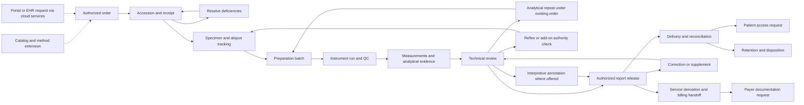
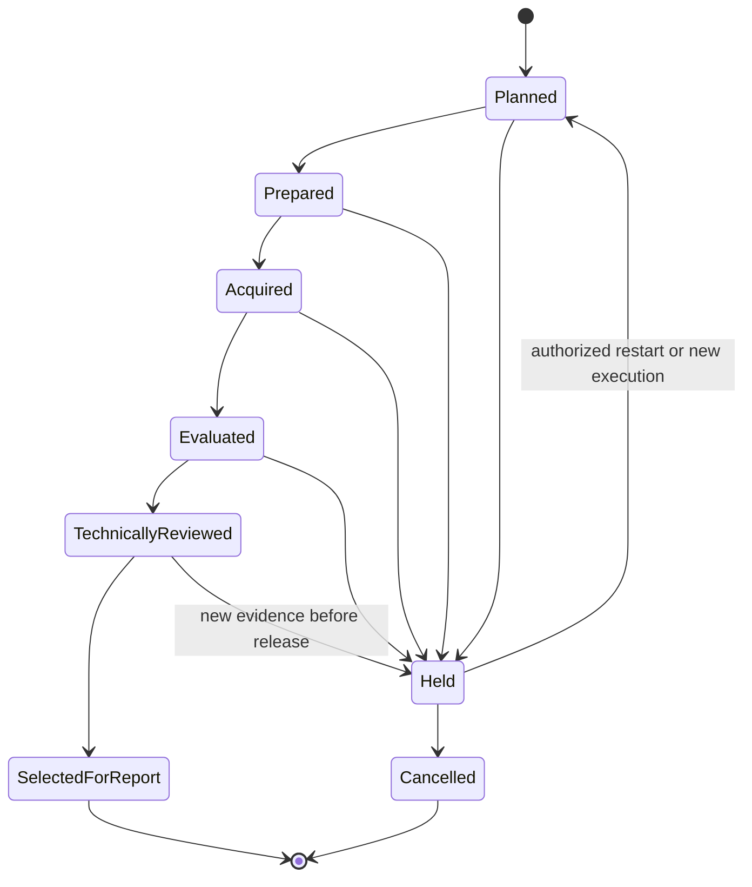

# Laboratory workflows and exceptions

Status: proposed workflows for US clinical toxicology ([scope](../project-scope.md#product-decision)). They describe intended behavior for implementation, not an implemented or approved laboratory SOP. WF-11–WF-15 and INV-11–INV-13 cover proposed outpatient drug monitoring. WF-16–WF-20 and INV-14–INV-16 cover the single host computer ([ADR 0009](../architecture/decisions/0009-single-computer-local-lis.md)) and the optional cloud services, which remain proposals ([ADR 0010](../architecture/decisions/0010-optional-cloud-services.md)). See [practice rationale](../research/laboratory-practices.md), [cloud-services research](../research/cloud-services.md), [functional requirements](functional-requirements.md) and [domain model](../architecture/domain-model.md).

## Personas and decision authority

| Persona | Main work | Authority boundary |
| --- | --- | --- |
| Ordering clinician / authorized client user | Submit requests with per-patient test selection, supply clinical context, diagnosis/indication and medications, receive authorized reports | Can access only permitted client/patient relationships; cannot edit laboratory observations. |
| Collector / courier | Identify collection, label, document handoffs and transport | Cannot release results or resolve a patient mismatch by relabeling without the correction process. |
| Accessioner / client services | Match orders, receive containers, resolve deficiencies, communicate issues | Can hold or reject under policy; identity merges/corrections require additional privileges. |
| Bench technologist / analyst | Aliquot, prepare, run, assess instrument outputs and technical evidence | Must have current method-specific authorization; cannot bypass nonoverridable release gates. |
| Technical reviewer | Evaluate run/QC and result evidence; require repeat or investigation | Review authority is distinct from system administration and from authorized release. |
| Authorized signatory / laboratory director | Release results, approve interpretations, authorize applicable exceptions | Qualifications and separation requirements are laboratory-specific policy. |
| Quality manager | Review deviations, QC trends, corrective actions and release impact | Does not silently alter original records; coordinates investigation and signed resolution. |
| Billing / revenue-cycle staff | Reconcile performed services and billing handoff; supply/review class-mapping content and approve code assignment; answer payer records requests | An administrator approves/activates application mappings under ADR 0018; billing content approval alone does not activate configuration. Cannot change analytical outcomes, treat order authorization as payment approval, or supply diagnosis codes or order scope for the orderer. |
| Interface / operations administrator | Resolve failed deliveries, mappings and infrastructure incidents | Can replay controlled exchanges; cannot manufacture clinical approval. |
| Privacy/security administrator / auditor | Manage access policy and inspect evidence | Access to audit functions does not automatically grant clinical release authority. |
| Patient / subject | Receive permitted access to issued information | The patient portal and its identity proofing are a proposed later external service (REQ-SVC-010, Q-35); the pilot must still support the laboratory's required access process. |
| Clinic user / clinic administrator | Clinic staff who submit orders, print requisitions and labels, follow status and view released reports in the client portal; the clinic administrator manages that clinic's users and locations | Sees only the furnishing laboratory's ordering and results for permitted locations (REQ-ORD-011). Portal submissions, cancellations and add-ons are requests until the LIS decides. Cannot change laboratory records or see other clinics' or laboratories' data. |
| Lab administrator of the host computer | Holds OS administrator rights on the host (Windows, macOS or Linux); keeps the host powered, awake, signed in to the OS and the LIS app open while analyzers run; installs approved updates, runs and tests backups, keeps the recovery kit, enrolls and revokes the device, manages local accounts and health alerts | Is the most privileged local actor, so tamper evidence relies on anchors leaving the computer ([ADR 0008](../architecture/decisions/0008-tamper-evident-audit-and-immutable-recovery.md)). Administration grants no release, QC or identity authority. Records application update approval and version acceptance under ADR 0018; the laboratory retains its formal acceptance and validation evidence, which may be external (WF-17). |
| Service provider support engineer | Workforce of a service provider, a business associate; runs the cloud services, monitors queues and backups, and supports the laboratory | Has no clinical authority and never creates or changes clinical state (INV-14). Support access to PHI is approved by the laboratory, time-limited, logged and US-only. Cannot install an update or delegate a backup key without the laboratory's recorded decision. |

One person may hold multiple roles only where authorized. Role membership alone does not prove current training, method competence or authority for a particular site/program. In a small laboratory the lab administrator may also be a technologist or the director; the system still records which role each action used. Whether one person may do both steps of configuration approval, report release or destination verification is the laboratory's versioned separation-of-duties policy ([ADR 0015](../architecture/decisions/0015-separation-of-duties-policy.md)), and a laboratory that one person runs gives that person every role.

## End-to-end workflow

The cloud services sit outside this flow: they carry requests in and released reports out, and every state above is decided on the host computer (INV-14).

The order may request definitive testing directly. A positive screen is not a universal prerequisite for a definitive test; automatic reflex behavior requires an approved rule and ordering authority. The follow-on authority check records any order-scope change before existing material is reused. Screening/confirmation describe a test's role in the clinical sequence; presumptive/definitive describe method certainty. A first-line definitive test is not mislabeled as confirmation of a screen that never occurred.

| ID | Trigger and owner | Required actions and evidence | Exit / exception |
| --- | --- | --- | --- |
| WF-01 Order intake | Clinician, portal, referral or negotiated interface | Validate submitting authority; preserve source/placer ID; resolve patient identifiers; capture catalog version, requested components, collection matrix, clinical context/AOEs, requestor and delivery destinations; record reflex authorization. For drug monitoring also record, with source, the per-patient selected method certainty and classes/analytes, ordering practitioner/NPI and any dated enrollment check, signature or intent evidence, supplied diagnosis/indication, medications, client point-of-care results with provenance, billing responsibility and any standing order (with its copy, scope and expiry) or order set used; check completeness against the versioned order policy (Q-21). | Accepted, clarification hold or rejected. Duplicate requests reconcile without creating duplicate test/charge obligations. Missing order authority (including an expired, exhausted or out-of-scope standing order, or a signature/intent that laboratory policy requires) holds the order for clarification before testing; missing payer documentation creates a billing review item, never a clinical hold. The laboratory never supplies diagnosis, indication or scope on the orderer's behalf, and a practice-wide profile is never auto-applied. The client portal (WF-16) and a hosted EHR interface endpoint are also order sources. Their submissions are requests: a cloud receipt or commit acknowledgement is never acceptance, and only this workflow on the host computer accepts, holds or rejects (INV-14). |
| WF-02 Collection and receipt | Collector then accessioner | Record collection event and identifiers, plus collector-attributed collection-site observations where policy requires; receive containers with site/time/condition; compare labels and order; assign accession; apply method/program acceptance policy; attach requisition evidence with access controls. | Received material is accepted, conditionally accepted under authorized policy, held or rejected. Missing collection time remains unknown and visible. |
| WF-03 Tracking and preparation | Accessioner / bench analyst | Scan storage moves; allocate volume; reserve material; create aliquot lineage; document dilution, extraction, hydrolysis or other preparation when part of the method; record reagent/control/calibrator lots and actors. | Prepared material is assigned to runs or held. Insufficient volume, storage excursion and seal discrepancy create explicit exceptions. |
| WF-04 Run and quality assessment | Analyst / technical reviewer | Verify method authorization and equipment readiness; record worklist positions; import supported vendor output from a registered upstream review system, applying [re-export semantics](../architecture/domain-model.md#upstream-analytical-review-and-re-export); reconcile every material identity; assess calibration, blanks, QC and sample-level evidence under frozen rules. | Accepted evidence moves to result evaluation; failed/unresolved evidence stays held. Batch-level acceptance may differ by analyte only when the method allows it. |
| WF-05 Result evaluation and follow-on testing | Analyst / reviewer | Preserve raw export and processing revision; apply approved units, dilution, decimal, cutoff and censoring rules; evaluate specimen validity and apply its approved report consequences; classify follow-on work as an analytical repeat, authorized reflex/add-on or recollection. | Candidate result set is reviewable with all prior attempts. Choosing each reportable analyte/attempt requires an attributable reason; repeated analysis does not itself authorize extra ordered tests or charges. |
| WF-06 Review and release | Technical reviewer then authorized signatory | Bind technical review to selected analyte/result revisions and their identity, preparation, calibration, QC and specimen dependencies; resolve release gates; record the approved location code when review or release is remote; snapshot results, identity, catalog/method/template versions and performing laboratory into report revision. | Release atomically records approval, immutable report content and delivery obligations. Changed evidence invalidates affected approvals; partial reports retain outstanding components and finalization reconciles their terminal dispositions. |
| WF-07 Delivery and urgent communication | Delivery worker / client services | Deliver only to authorized destinations; track rendered/structured content by report revision; reconcile application receipt; retry bounded failures; communicate urgent findings under lab-defined policy with recipient/read-back/escalation evidence if required; submit jurisdiction-required reportable results where enabled. Send PHI only to verified destinations (REQ-RPT-012); record each outcome with its channel and evidence level (REQ-RPT-011); treat the cloud channels (portal, print agent, fax, Direct, EHR endpoint) as part of the laboratory's delivery chain and run the lab-scheduled check that content arrives intact (REG-047). | Reconciled at the evidence level the channel can reach (for example "fax provider reports transmitted", "Direct processed", "portal viewed by named user", "HL7 application accepted"), awaiting reconciliation, outcome unknown, failed or escalated; never a bare "delivered" (INV-15). Transport ACK and clinician acknowledgement are distinct. |
| WF-08 Correction, withdrawal and addendum | Authorized signatory / quality manager | Identify affected results/report revisions and recipients; document reason; preserve original; review revised evidence; issue corrected, supplemented or withdrawn status according to policy; reconcile each recipient's notification and authorized replacement. Send the withdrawal or correction event to the cloud ahead of other queued items, so the portal marks the cached revision "revision pending" or withdrawn on receipt, before new content arrives; list any portal views of the withdrawn revision between LIS commit and cloud marking for notification review (REQ-RPT-013). | New revision references previous revision. Wrong-patient correction separates withdrawal/error notice to the original destination from disclosure of the correct patient's report; identity reassignment alone does not authorize redelivery. No cloud copy shows a withdrawn or superseded revision as current once the cloud has the event. |
| WF-09 Referral and service reconciliation | Referral coordinator / billing | Authorize referral, package traceable material, capture reference-lab identifiers and expected tests; reconcile returned results and performing lab; retain the external report unchanged; hand off performed services to billing (WF-12) with reversals/adjustments where appropriate. | Referral results and interpretation retain source fidelity. Missing components, changed methods, unexpected components and ambiguous external patient matches stay held for reconciliation; a direct-to-requestor referral report still needs an exact retrievable copy. |
| WF-10 Retention, downtime and recovery | Operations / quality / authorized records custodian | Apply material and record schedules separately; honor holds; document disposal. During outage, use controlled identifiers and local records; reconcile backlog, manual reports, instrument evidence and charge/delivery duplicates after recovery. Three outage kinds differ. **Host-computer outage** (hardware, power, OS failure, ransomware): the whole local LIS is down; use paper downtime records and printed requisitions, keep analyzers spooling where they can, and recover in place or by WF-18. **Cloud or internet outage**: every local workflow continues (REQ-OPS-009); portal, EHR relay, cloud delivery and managed backup queue with visible age; clinics fall back to fax, phone and printed requisitions, and the lab delivers manually from the application. **Listening gap**: the app is closed, the OS session is signed out, or the computer reboots or installs an OS update. The app has no background service, so nothing is received in that interval ([ADR 0009](../architecture/decisions/0009-single-computer-local-lis.md#consequences)). Analyzers keep unacknowledged messages and retransmit when the app reopens; watched-folder files wait; on every start the app records the closed interval, reconciles interrupted imports and outstanding expected results, and opens a work item for each missing or partial result (REQ-OPS-013, REQ-INT-009). | Recovered work is attributable to actual event times and later entry times. No unresolved backlog is hidden by a healthy infrastructure indicator. After a listening gap, every expected result is received, re-requested or held with an owner, and the gap interval is visible. Cloud queues drain in order without duplicates; the portal shows the lab's last-sync time throughout. |
| WF-11 Medication-consistency interpretation | Configured rule evaluation, then interpretive reviewer and authorized signatory; disabled unless Q-22 enablement, validation and the Q-26 intended-use assessment are recorded | Snapshot medication statements, their as-of date and mapping version; withhold or flag the comparison under laboratory policy when the list exceeds its approved maximum age; confirm executed scope, validity state and selected result revisions; apply the approved rule version, producing only deterministic comparison categories with no dose, timing, adherence or diversion conclusion; flag unmapped medications, presumptive-only inputs and expected analytes outside tested scope; reviewer accepts, amends with reason or withholds under policy. | Annotation released within a report revision or withheld with reason. Changed inputs before release invalidate it; after release, any change to released annotation or medication-list content creates a new report revision through WF-08. |
| WF-12 Billable-service derivation and handoff | Billing owner; derivation per approved policy | At the policy-defined point (component disposition or release), group executed work by patient and configured date-of-service rule; apply the approved class mapping to in-scope executed components; produce presumptive/definitive service candidates with an explanation; technical repeats never add classes; count a failed attempt only under the billing owner's approved policy, never beyond the ordered scope and never in addition to a successful repeat of the same class; exclude validity work unless policy says otherwise; exclude and flag performed-not-ordered items; flag ordered-not-performed items, presumptive plus top-tier definitive on one specimen, more than one presumptive per date of service and counts over configured payer frequency windows, never blocking clinically ordered testing; hand off idempotently with classes ordered/performed/reported, billing responsibility and notices as supplied. | Handed off, acknowledged, rejected or held for missing mapping/policy. Later cancellations, corrections or same-day accessions produce referenced adjustments, never silent rewrites. |
| WF-13 Payer or auditor documentation request | Billing/compliance owner with privacy review | Register requester, claim/service, legal basis and due date; verify requester; assemble the package from retained order, authorization, collection, derivation, report-revision and handoff evidence; apply minimum-necessary and Part 2 review; approve, submit and log the disclosure. Route requests for clinical-record evidence to the ordering practitioner. | Submitted, extended or escalated before the due date. The package is reproducible; no record is created or altered to answer the request. |
| WF-14 Catalog and method extension | Administrator activates application configuration; laboratory director/technical supervisor, quality lead and billing owner supply/approve applicable content | Propose the analyte/class/matrix change with rationale (for example local drug trends); validate the method; prepare terminology mapping, limits/cutoffs, report placement, billing-class mapping and interpretive-rule changes. Formal laboratory evidence may remain external. The administrator approves and activates the exact configuration version under configured separation of duties, with audit attribution and optional external approval reference; notify clients under laboratory policy. | The new current version applies to new orders. Incomplete dependent configuration blocks activation; accepted orders retain scope and approved method versions through start, completion and repeats. Routine supersession does not drain or repin work; explicit safety retirement and holds continue to block unsafe use. Historical observations and issued artifacts remain unchanged (ADR 0018). |
| WF-15 Patient access and EHI export request | Privacy officer / client services | Verify patient or representative identity and authority; locate issued report revisions and other designated-record-set content the LIS holds; apply access, information-blocking, jurisdiction, Part 2 and deadline policy; provide the exact issued content with current corrected/withdrawn status, or a complete export in a standard or agreed format; record any individualized delay or exception with reason; log the disclosure. This runs as a manual route in the application; a patient portal is a proposed later external service (REQ-SVC-010, Q-35) that must follow the same rules and REG-050. | Fulfilled, denied or extended with documented basis, or escalated. Never a reconstruction, an unlabeled superseded revision or a blanket configured delay. |
| WF-16 Portal order with offline queue and lab acceptance | Clinic user submits; accessioner / client services decides on the host computer | The cloud stores the order version with a durable receipt ID and version hash and shows "received by portal" with the lab's last-contact time. The host connector pulls queued orders when online, commits them to the LIS durable inbox and returns the LIS receipt ID ("received by lab"). The LIS runs WF-01 checks (authority, order policy, frozen catalog version, identity resolution with the portal patient ID scoped to the clinic) and returns accepted, clarification hold or rejected with reason and actor. Status, questions and result availability return to the portal. Cancellation and add-on are requests the LIS decides. If the specimen arrives first, accession from the self-sufficient requisition and reconcile when the cloud order arrives (REQ-ORD-009). | Accepted, on clarification hold or rejected, decided only by the LIS. Unretrieved past the lab-set limit: owned exception and alert to lab contacts, still "received by portal". Redelivery reconciles once; same order ID with changed content becomes a new version or a quarantined conflict; a stale catalog component raises an exception, never a silent substitution. |
| WF-17 Software update approval and rollback | Lab administrator records application approval; laboratory owns clinical acceptance evidence | Verify the signed, expiring update manifest and the package for the host's OS (Authenticode-signed MSI or NSIS on Windows, Developer ID signed and notarized app on macOS, signed AppImage, .deb or .rpm on Linux), and its Minisign signature when the Tauri updater applies it; review change summary, risk class and validation evidence; optionally stage on a test copy restored from a snapshot; record administrator application approval and identify the laboratory acceptance evidence, which may remain external; schedule outside active runs; pause listeners so analyzers retransmit unacknowledged frames; take and verify a pre-upgrade snapshot; invoke the updater or install the OS package; the app restarts and runs startup reconciliation (REQ-OPS-013); run the lab's post-install function checks from the synthetic case pack on that OS; resume (REQ-OPS-006). An OS or web-engine update that arrives outside our releases is recorded and followed by the short UI smoke check before clinical use ([ADR 0012](../architecture/decisions/0012-rust-tauri-desktop-application.md)). | Applied and accepted for clinical use, or declined with the risk recorded. Unsigned, expired or downgraded manifest: refused and alerted. Install failure: the installer rolls back. Failure after install: restore the pre-upgrade snapshot, reinstall the prior signed package for that OS and reconcile work done since. UI smoke check fails after an OS or web-engine update: hold clinical use on that host and escalate (NFR-33). Nothing installs silently, including security patches. |
| WF-18 Restore to a replacement computer | Lab administrator with the laboratory director; service provider support optional | Declare downtime (WF-10); revoke the old device (WF-19) before the replacement connects; prepare a computer meeting the host baseline for its OS (Q-29), with full-disk encryption on and power and sleep settings per the setup checklist, rebuilding the OS first after ransomware; install the same signed version for that OS; enter the off-PC recovery kit, which restores keys into that OS's key store; restoring onto a different supported OS than the lost host is allowed only once that path has been validated; choose the latest verified snapshot, using an immutable copy if compromise is suspected; restore and verify integrity, artifact digests and audit-chain heads against off-PC anchors; enroll the new device; reconcile work since the snapshot from worksheets, analyzer retransmission, cloud-held receipts, released-report copies and manual reports; record elapsed time; record sanitization or disposal of the old disk; open an incident assessment for loss or theft (REQ-OPS-007, REQ-OPS-002). | Restored and reconciled; release resumes only for work whose evidence is reconciled. Unrecoverable gap: affected work stays held with an owned item. Missing recovery kit or key: the backup is unusable and the case escalates as an incident (see exceptions). |
| WF-19 Device enrollment and revocation | Lab administrator; service provider support for the cloud side, without clinical authority | Start enrollment on the host to obtain a one-time code; an authorized lab user confirms it in the laboratory's cloud console; the host creates a key (in the OS key store, hardware-backed where available) and receives a certificate bound to that laboratory; issuing it revokes any previous certificate, leaving one active device; queued cloud items are resent to the new device under their idempotency keys. Revoke on restore, replacement, suspected compromise or cancellation (REQ-SVC-001). | Enrolled with exactly one active device, or revoked. Traffic from a revoked device is rejected and alerted. An expired code is reissued. Revocation never deletes cloud-held data; exit follows REQ-SVC-005. |
| WF-20 Clinic onboarding to the portal | Laboratory client services with the compliance officer; clinic administrator | Record the clinic, locations and ordering practitioners with NPI; record the onboarding criteria applied, which never use referral value, order volume or payer mix (REG-046); publish the lab-approved catalog subset; verify delivery destinations (REQ-RPT-012); create the clinic administrator with MFA, who then creates clinic users within scope; train; record every item furnished (portal accounts, print agent, label printer, supplies, interface) with dates and approver (REQ-BIL-003); confirm the limited-use terms (REQ-ORD-011); confirm routing and requisition printing with a synthetic test order. | Active, suspended or offboarded (users disabled, report-history access per lab policy, records retained). A request for features beyond the furnishing lab's ordering and results, a combined multi-lab view, or payment of the clinic's EHR-vendor fees is declined or routed to counsel (Q-32). |

## State transitions

States belong to separate entities; a single accession status cannot represent all work. Suggested aggregate display states derive from underlying records and never replace them.

| Entity | Normal transitions | Exceptional transitions and guards |
| --- | --- | --- |
| Order item | Draft → submitted → accepted → in progress → completed | Submitted/accepted → clarification hold or rejected. A cancellation request has its own pending/accepted/declined decision; accepted cancellation preserves performed work and issued reports. Completion requires every expected component to have a terminal disposition, including approved cancellation/not-performed reasons. |
| Specimen acceptance | Awaiting receipt → received → accepted | Received → held/rejected; held → accepted/rejected after resolution. Conditional acceptance is an explicit decision with a policy and scope. Rejected material cannot enter testing without an authorized changed decision where policy permits. |
| Material lifecycle | Available → reserved → in use → stored → disposed | Quarantine/released-from-quarantine is independently tracked. A volume can be exhausted without being physically disposed. Disposition cannot erase lineage or violate a hold. |
| Test execution | Planned → prepared → acquired → evaluated → technically reviewed | Any pre-release stage → held; held → authorized resume/new attempt/cancel. A rerun is a new execution related to the original. One order may have several executions. |
| QC assessment | Pending → accepted or rejected | Later evidence may produce a superseding assessment and impact review. Original failed QC is never relabeled as passing. |
| Report revision | Draft → ready for release → released | Draft can be abandoned with evidence. A released revision is immutable; a new corrected/supplemental revision supersedes it, or a withdrawal event changes current availability/status while retaining history. |
| Delivery obligation | Pending → dispatched → channel evidence recorded (named level) → application reconciled where the channel supports it | Retryable failure → retry; terminal/expired → owned escalation; no signal within the channel timeout → outcome unknown → reconciliation. Read/clinical receipt, when required, is separate from application reconciliation. Unverified destination → blocked. |
| Portal order, cloud view | Draft → received by portal → received by lab → accepted, clarification hold or rejected | Unretrieved past the limit → owned exception (state unchanged); changed content under the same order ID → new version or conflict; cancellation or add-on → requested, then decided by the LIS. The cloud never advances an order past "received by portal" on its own. |
| Cloud report copy | Absent → current → superseded (prior revision labeled) | Correction or withdrawal event → revision pending → current (new revision) or withdrawn. Never holds an unreleased revision. |
| Software update | Offered → verified → approved → snapshot verified → installed → function-checked → in use | Verification failure → refused; declined → recorded; install failure → rolled back; post-install failure → pre-upgrade snapshot restored and prior version reinstalled. |
| Device certificate | Code issued → enrolled (active) → revoked | Code expired → reissue. Enrolling a new device revokes the previous one; at most one active device per laboratory. |
| Interpretive annotation | Pending inputs → evaluated → reviewed → released with report revision | Any input change → superseded; unmapped/out-of-scope/presumptive input → flagged or withheld with reason. Never edits a result revision. |
| Billable service | Pending → derived → handed off → acknowledged | Missing mapping/policy → held; rejected → owned rework; later change → referenced adjustment. Replay creates no second service. |
| Documentation request | Received → verified → assembled → approved → submitted → closed | Unverified requester or overdue → escalated; extension requested is recorded. |

This diagram is deliberately partial: it is a conceptual test-execution state machine, not the final permitted-transition specification. A selected execution can appear in an issued report; later defects use WF-08 and do not mutate that historical execution/report relationship.

## Follow-on work and release boundaries

An analytical rerun, dilution or re-extraction attempts to fulfill an existing authorized order under its approved method. Reflex testing or an add-on changes requested testing and needs recorded authority and scope; a laboratory rule or payer policy alone is not a universal authorization. Add-ons recheck remaining material, stability, matrix, method compatibility and holds against the proposed execution. A new collection gets a new specimen identity. Whether work is separately chargeable remains the billing owner's independent decision.

Cancellation is a request until accepted at a known processing point. Acceptance prevents new governed work for the cancelled component, while an already acquired or late arriving result remains evidence for reconciliation. It cannot silently reopen testing, release a result or create a charge. If release committed first, use the correction/withdrawal workflow as applicable rather than deleting the report. Preserve partner cancellation acknowledgements and the laboratory's final disposition separately.

Technical approval is scoped to the selected result revisions, including per-analyte selection from different authorized attempts where the method permits it. An accepted run does not approve every patient observation. Release evaluates each selected result's material/preparation, calibration/QC, sample evidence and required validity dependencies; one failing preparation may affect several runs, and one failing analyte may affect several specimens. A partial report can release only independently eligible components under laboratory-approved policy. Its pending/held/not-performed entries are explicit and cannot appear as negative findings.

A conditionally authorized reflex has a trigger assessment separate from a testing obligation. Record whether the condition was met, not met or remains unresolved, with evidence and rule version. A condition-not-met decision can account for the unactivated component without a fabricated negative/cancelled test. Finalization resolves every trigger assessment and the terminal disposition of each activated obligation; an unresolved trigger cannot silently disappear.

Drug monitoring keeps four scopes distinct: the **ordered** scope chosen by the clinician for this patient, the **method** scope an execution can measure, the **reported** scope released to the recipient and the **billed** scope derived for the date of service. Reported and billed scope never exceed the authorized ordered scope; a method measuring more does not widen either. Each detection outside the ordered scope opens an owned review item with ageing and an explicit disposition under laboratory policy (Q-08), such as director review and an authorized add-on request to the clinician; it is never silently reported, billed or discarded, and its billing flag is separate. Whether unreported measurements belong to the designated record set is a privacy/counsel decision (Q-15). Medication-consistency annotations compare only within executed scope. These are proposed guards; payer applicability is owned by the billing/compliance owner ([laboratory practices](../research/laboratory-practices.md#outpatient-drug-monitoring-practices)).

## Safety and integrity invariants

| ID | Invariant |
| --- | --- |
| INV-01 | Every patient result traces to an authorized order item, patient identity assertion, specimen/material lineage, test execution, approved method version and original evidence. |
| INV-02 | A foreign identifier is unique only within its assigning authority and object type; ambiguous identity and conflicting duplicate payloads stay quarantined. |
| INV-03 | No released report is overwritten. Its identity snapshot, results, units, cutoffs, comments, template and signatory remain reproducible. |
| INV-04 | Replaying the same request/import/release/delivery event cannot create a second clinical result, report revision or financial obligation. A changed payload with the same key requires resolution. |
| INV-05 | Unresolved required QC, identity, method-authorization or specimen-acceptance gates prevent release; system administration does not bypass them. |
| INV-06 | Censored, absent, invalid, not performed, qualitative and exact numeric observations remain distinguishable through export, report and reimport. |
| INV-07 | Catalog, method, rules, mapping and terminology changes never silently change an existing execution's meaning or previously issued content. |
| INV-08 | Every correction, manual result entry, material relabel, exception and release has actor, event time, entry time, reason and preserved prior evidence. |
| INV-09 | Access follows lab/site/client/program authorization at every read, write, search, export and background-delivery boundary. |
| INV-10 | Material and record deletion is blocked by applicable retention or legal holds; disposal produces durable evidence without breaking traceability. |
| INV-11 | An interpretive annotation is a derived record referencing exact result revisions, medication snapshot, validity state and approved rule version. It never alters an analytical result, and an analyte outside executed scope is never presented as not detected. |
| INV-12 | Billable services derive from executed work within authorized ordered scope under a versioned class mapping and date-of-service rule. Result values, positivity, technical repeats and replays never change the derived class count; a failed attempt counts only under the billing owner's approved policy, within the ordered scope and never in addition to a successful repeat. |
| INV-13 | Order scope, diagnosis/indication, medication context and authentication evidence are recorded as supplied with their source. The system never fabricates, defaults or infers them and never asserts medical necessity. |
| INV-14 | The cloud never creates or changes clinical state. Portal orders, EHR messages, cancellations and add-ons arriving through the cloud are requests until the LIS on the host computer decides; cloud copies of reports are projections of released revisions only. |
| INV-15 | Every delivery status names its channel and evidence level. No record, screen or export shows a bare "delivered"; missing confirmation is "outcome unknown", never success. |
| INV-16 | Safety and exit functions are part of the application and work without any hosted service: safety fixes, backup to lab-owned targets, restore and restore test, complete export, per-patient EHI export, manual delivery and lab-run interfaces. Tamper-evidence anchoring to a lab-owned write-once target or offline media is proposed for the same floor (Q-30). |

## Exception acceptance scenarios

| Scenario | Expected operational response | Related workflows |
| --- | --- | --- |
| Two patients share name/date of birth | Keep identifiers and sources distinct; require identity resolution with evidence; do not auto-merge. | WF-01, WF-02 |
| Patient merge later proved wrong | Controlled unmerge/correction, impact inventory across reports/interfaces, restriction of incorrect exposure, reissued reports where needed. | WF-08 |
| A directly ordered definitive test has no screening result | Follow the authorized definitive method; do not invent a screen, require a positive screen or add an unrequested presumptive test. | WF-01, WF-05 |
| Reflex is triggered twice while cancellation is pending | Resolve order authority and cancellation state; authorize at most one follow-on item; retain attempts and do not duplicate services. | WF-01, WF-05 |
| Add-on requested after material is exhausted or unstable | Record the request and infeasibility; seek authorized alternative/referral or recollection; do not silently reuse unsuitable material. | WF-01, WF-03, WF-09 |
| Container barcode reprinted | Reprint same material identity with actor/reason; obsolete label is documented; new aliquot gets a new identity. | WF-02, WF-03 |
| Split specimen requested by an external program | Preserve A/B relationships, seals, custody and reserved volume; use only an approved program workflow; initial clinical pilot cannot claim federal split compliance. | WF-03, WF-09 |
| Unexpected result despite passing run QC | Hold the sample/result for technical assessment; authorize follow-on testing under policy; maintain all attempts. | WF-04, WF-05 |
| One analyte QC fails in a multianalyte run | Hold affected analytes and propagate to impacted specimens; partial acceptance/release only under validated policy. | WF-04, WF-06 |
| Extraction defect affects aliquots later split across runs | Follow preparation/material dependencies to every affected result and report, including runs whose instrument QC passed. | WF-03, WF-04, WF-08 |
| One analyte is rerun after other components are approved | Review the changed analyte/result revision and dependencies; preserve unaffected approvals only where still valid; do not select the newest whole file by default. | WF-05, WF-06 |
| QC defect discovered after reporting | Search affected lots/runs/analytes/report versions; open impact assessment and correction/notification obligations. | WF-08 |
| Test menu changes while samples are in flight | Continue frozen authorized versions or explicitly migrate with review; never add/drop ordered components silently. | WF-01, WF-05 |
| Duplicate file versus edited file with same run ID | Exact repeat reconciles once; changed evidence becomes a new processing revision or quarantined conflict, never an implicit replacement. | WF-04 |
| EHR accepts connection but rejects observation code | Delivery stays unreconciled; alert interface owner; correct approved mapping and replay the intended report revision. | WF-07 |
| Report sent to wrong client endpoint | Disable incorrect routing, preserve exposure evidence, invoke incident process, correct recipient mapping under review. | WF-07, WF-08 |
| Referral returns an incomplete or corrected report | Preserve external revision and outstanding components; follow local review/issuance policy; update recipient obligations. | WF-09, WF-08 |
| Referral's interpretation conflicts with local preferred wording | Preserve the performing laboratory's result and interpretive information; seek clarification/correction from that laboratory through the approved process. | WF-09 |
| A held or referred test exceeds the lab's expected reporting time | Assess urgency under the approved policy, record whether delay notification is needed and track required communication; an ageing queue alone does not close the duty. | WF-07, WF-09 |
| Outage requires a manually issued urgent report | Record controlled manual report identifier and signatory; reconcile later with exact issued content and all recipients before electronic redistribution. | WF-10, WF-07 |
| Practice-wide identical profile used as a standing order, or an expired, exhausted or out-of-scope standing order | Never auto-apply the profile; flag profile use for compliance review. A standing order lacking authority holds the order for clarification before testing; do not narrow, widen or confirm scope on the clinician's behalf. | WF-01 |
| Requisition arrives with diagnosis codes pre-printed by a laboratory-supplied form | Flag under the order policy; accept only codes attributable to the orderer; record the source artifact. | WF-01, WF-13 |
| Client performed point-of-care presumptive testing and requests reflex | Record the client result with point-of-care provenance; definitive testing follows the order's clinical authority; payer non-coverage raises a billing review flag only; never import it as a laboratory result. | WF-01, WF-05, WF-12 |
| Two accessions collected the same day for one patient | Derive one service per family for the date of service under the configured rule; classes tested in both count once; adjust if the second arrives after handoff. | WF-12 |
| Method detects an unordered drug | Exclude from report and billing by default and flag the performed-not-ordered item; open an owned clinical review item with ageing and an explicit policy disposition (Q-08), such as director review and an authorized add-on request. | WF-05, WF-07, WF-12 |
| Listed medication cannot be mapped, or its expected metabolite is outside the tested scope | Withhold automatic comparison for that entry or show *not tested*; analytical results are unchanged. | WF-11 |
| Clinician corrects the medication list after release | Re-evaluate under the originally frozen rule version unless correction policy says otherwise; any change to released report content, including the displayed medication list or annotation, creates a new report revision with recipient reconciliation. | WF-11, WF-08 |
| All definitive results negative on a specimen in a laboratory-defined dilute category | Release only with the approved validity qualifier or follow the approved hold/recollection action; never as an unqualified negative. | WF-05, WF-06 |
| New emerging-substance analyte is activated while specimens are in flight | In-flight orders keep frozen scope; testing retained material requires an authorized add-on within stability; earlier reports remain unchanged. | WF-14, WF-01 |
| Patient disputes a result | Retrieve retained material if within retention and stability; any retest needs order authority, links to the original and preserves both results. | WF-03, WF-05, WF-08 |
| Payer requests records for a claim whose report was later corrected | Package includes the order history, every issued revision, the correction reason and handoff adjustments; due date tracked. | WF-13 |
| Patient requests results for a withdrawn or corrected report | Provide authorized issued content with current status; do not disclose another person's information after a wrong-patient correction. | WF-15, WF-08 |
| Upstream review software re-exports a reprocessed batch after release | Create a linked processing revision; invalidate dependent reviews; open impact assessment and correction for released results; a partial re-export changes only included rows. | WF-04, WF-08 |
| Client asks for a standard multi-day delay before patients see results | Decline as configuration; permit only individualized delays with reason and expiry, recorded patient preferences or documented exceptions. | WF-15 |
| Portal order retrieved late because the host computer was off over a weekend | The order stays "received by portal" with the last-contact time shown; the overdue-retrieval alert reaches lab contacts; the clinic may print the requisition and collect. On reconnection the LIS accepts, holds or rejects it; turnaround is measured from receipt at the lab, and the delay is visible in the portal reconciliation report. | WF-16, WF-10 |
| Specimen and requisition arrive before the portal order is retrieved | Accession from the self-sufficient requisition: scanning fetches the order when online, otherwise staff enter it under the downtime SOP. When the cloud order arrives it reconciles to the same order by order ID and version; any difference goes to clarification, never a second order. | WF-16, WF-02, WF-10 |
| Clinic opens a cached report that was withdrawn while the host computer was offline | The cloud cannot know until the event arrives, so the portal shows the lab's last-sync time on every report. On reconnection the withdrawal event is sent first and the copy is marked withdrawn or "revision pending"; views of the withdrawn revision after the LIS commit are listed for the notification decision under WF-08. | WF-08, WF-16 |
| EHR partner treats the cloud's commit acknowledgement as order acceptance | The LIS application response still follows separately; the reconciliation report shows commit-acknowledged orders with no application outcome; the partner's readiness record is corrected, and the route falls back to portal completion or manual entry until the partner handles asynchronous responses. | WF-01, WF-07 |
| Update fails mid-install | The installer rolls back; if a migration started, restore the verified pre-upgrade snapshot and reinstall the prior signed version; analyzers retransmit unacknowledged frames once listeners resume; no clinical work resumes until the lab's function check passes; the failure is reported to the maintainers. | WF-17, WF-10 |
| Backup key or recovery kit lost | With the host alive: create a new key and recovery kit, take a full backup at once, store the kit off the computer and record the earlier backups as unrecoverable while retaining them under policy. With the host also lost: the encrypted backups cannot be restored and a service provider cannot decrypt them without an opted-in escrow; recover what exists from released-report copies, paper records and referral or analyzer sources, hold affected work, and handle it as an incident. | WF-18 |
| Host computer stolen | Revoke the device certificate at once so the stolen computer cannot dispatch; restore to a replacement (WF-18); open an incident assessment, where full-disk encryption (BitLocker, FileVault or LUKS) with an uncompromised key bears on whether the PHI was unsecured (counsel and privacy officer decide); if the old computer reappears, its traffic stays rejected and its disk is sanitized before any reuse. | WF-18, WF-19 |

Clinical and specimen facts informing this design are summarized in [laboratory practices](../research/laboratory-practices.md); interoperability semantics are sourced in [integration architecture](../architecture/integrations.md). The workflows themselves are proposed engineering and operating requirements, not externally mandated universal procedures.
